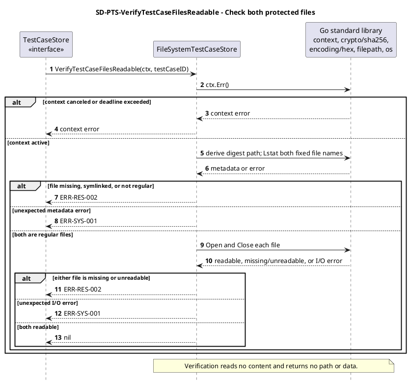

# SD-PTS-VerifyTestCaseFilesReadable — Verify Protected Files

| Field | Value |
|---|---|
| Sequence Diagram ID | `SD-PTS-VerifyTestCaseFilesReadable` |
| Owning subsystem | Protected Test Case Store Subsystem |
| Interface operation | `TestCaseStore.VerifyTestCaseFilesReadable(ctx, testCaseID)` |
| Element specification | [FileSystemTestCaseStore](../Specification/FileSystemTestCaseStore.md) |
| Status | Draft |
| Version | 0.1 |
| Date | 2026-11-18 |

