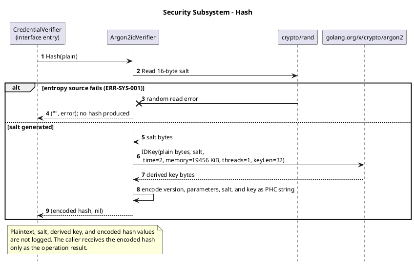

# Sequence Diagram — Security Subsystem — Hash

| Field | Value |
|---|---|
| Sequence Diagram ID | SD-SEC-Hash |
| Realized operation | `CredentialVerifier.Hash` |
| Internal realization | `Argon2idVerifier.Hash` |
| Status | Draft |
| Version | 0.1 |
| Date | 2026-11-18 |

## 1. Scope

Shows generation of a fresh random salt, Argon2id derivation with the current profile, PHC encoding, and the documented entropy-source failure.

## 2. Diagram

## 3. Notes

- The encoded string uses the Argon2id PHC identifier and version 19 with `m=19456,t=2,p=1`.
- The random salt is unique per invocation; the hash operation does not persist credentials.
- `ERR-SYS-001` is propagated to the caller, which aborts persistence.
