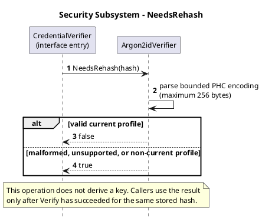

# Sequence Diagram — Security Subsystem — NeedsRehash

| Field | Value |
|---|---|
| Sequence Diagram ID | SD-SEC-NeedsRehash |
| Realized operation | `CredentialVerifier.NeedsRehash` |
| Internal realization | `Argon2idVerifier.NeedsRehash` |
| Status | Draft |
| Version | 0.1 |
| Date | 2026-11-18 |

## 1. Scope

Shows the bounded, non-cryptographic inspection that reports whether a hash should be replaced with the current Argon2id profile.

## 2. Diagram

## 3. Notes

- Current-profile matching includes algorithm, version, memory, iterations, parallelism, salt length, and derived-key length; the random salt value itself is not compared.
- A `true` result is a migration signal, not proof that the supplied password is valid.
