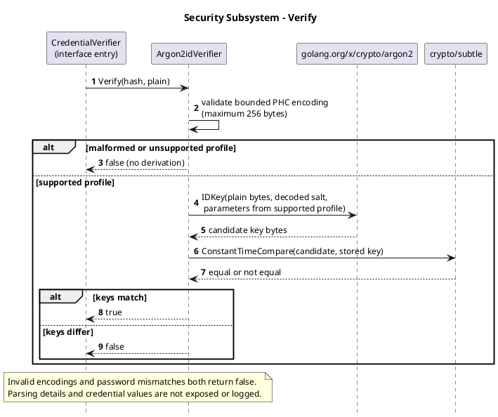

# Sequence Diagram — Security Subsystem — Verify

| Field | Value |
|---|---|
| Sequence Diagram ID | SD-SEC-Verify |
| Realized operation | `CredentialVerifier.Verify` |
| Internal realization | `Argon2idVerifier.Verify` |
| Status | Draft |
| Version | 0.1 |
| Date | 2026-11-18 |

## 1. Scope

Shows bounded PHC validation, Argon2id derivation for a supported profile, constant-time key comparison, and fail-closed handling of malformed or unsupported encodings.

## 2. Diagram

## 3. Notes

- Stored parameters are checked against an explicit bounded allowlist before they can control memory or CPU cost.
- Comparison uses equal-length derived keys and `crypto/subtle.ConstantTimeCompare`.
- The caller maps `false` to its generic invalid-credential behavior; the subsystem does not distinguish an absent account from a mismatch.
