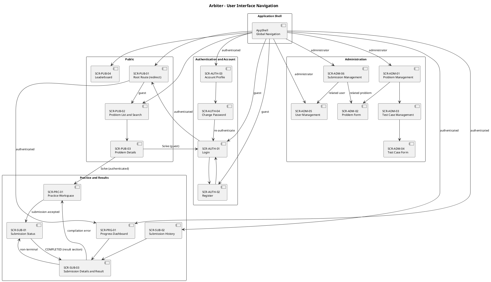

# User Interface Screen Inventory

**Arbiter — Online Judge Platform**

| Document control | Value |
|---|---|
| Project | Arbiter — Online Judge Platform |
| Artifact | User interface screen inventory |
| Behavioral basis | [Use case specifications](../../../RequirementAnalysis/UCSpec/) and [Use Case Catalog](../../../RequirementAnalysis/UCSpec/UseCaseCatalog.md) |
| Structural basis | [Design Class Diagram](../../ClassDiagram/DesignClassDiagram/DesignClassDiagram.md) and [React SPA class specifications](../../ClassDiagram/DesignClassSpecification/Index.md) |
| Status | Draft |
| Version | 0.2 |
| Date | 2026-11-17 |

---

## 1. Purpose and Scope

This document identifies the user interface screens of Arbiter from two sources:

1. the interaction steps, fields, confirmations, and navigation described in the human-actor use case specifications; and
2. the boundary classes in the `React SPA (TypeScript)` package of the design class diagram (DCD) that present information to, or accept input from, a person.

The result is a screen inventory, not a visual design. It fixes the set of screens, their ownership by a DCD boundary class, their use case traceability, their major regions and states, and their navigation. Layout, visual styling, and component-level implementation remain for later interface design.

Only the React SPA classes are user-interaction boundaries. The HTTP API handlers, application services, persistence adapters, queue, execution subsystem, and Judge Worker are system boundaries and therefore produce no screens. The system use cases `UC-SYS-J-01` and `UC-SYS-J-02` are excluded for the same reason.

## 2. Method and Definitions

The inventory was derived as follows:

1. Read every human-actor use case under `RequirementAnalysis/UCSpec/`.
2. Extracted each step that presents information to the actor, collects actor input, requests confirmation, or navigates to another interaction area.
3. Mapped those interactions to the React SPA boundary classes: `AppShell`, `AuthProvider`, `ProblemBrowser`, `PracticeWorkspace`, `SubmissionTracker`, `SubmissionBrowser`, `ProgressDashboard`, and `AdminConsole`.
4. Consolidated interactions that share one addressable view, and separated views that serve different use cases or have different entry points.
5. Recorded supporting API clients and state types separately, because they do not themselves interact with users.

| Term | Meaning in this document |
|---|---|
| **Screen** | An addressable, route-level view with its own navigation target. A screen may contain embedded regions. |
| **Routing entry** | An addressable route that resolves to another screen without rendering independent content, such as the root route. |
| **Embedded region** | A panel or mode inside a screen that does not have its own navigation target, such as the search controls of the problem list or the language selector of the practice workspace. |
| **Overlay** | A modal confirmation or warning rendered over a host screen. Overlays realize confirmation steps in the use cases and are listed separately. |
| **Transient state** | A loading, empty, validation, error, conflict, or unknown-outcome presentation within a screen. |

A single use case can span more than one screen. A single screen can serve more than one use case when the use cases share the same view and differ only in mode or action, for example problem create and problem update.

### 2.1 Boundary classes that interact with users

| DCD boundary class | User-facing responsibility | Screens |
|---|---|---|
| `AppShell` | Global shell, guest/authenticated navigation, root route resolution, account child routes | `SCR-PUB-01` (routing entry), `SCR-AUTH-03`, `SCR-AUTH-04` |
| `AuthProvider` | Session state and login, registration, logout, and restore flows, hosted by `AppShell` | `SCR-AUTH-01`, `SCR-AUTH-02`, `DLG-AUTH-01` |
| `ProblemBrowser` | Public problem browsing, search, selection, and problem details | `SCR-PUB-02`, `SCR-PUB-03` |
| `ProgressDashboard` | Own statistics and public leaderboard presentation | `SCR-PUB-04`, `SCR-PRG-01` |
| `PracticeWorkspace` | Source editing, language selection, and solution submission | `SCR-PRC-01`, `DLG-PRC-01`, `DLG-PRC-02` |
| `SubmissionTracker` | Submission status polling and outcome presentation | `SCR-SUB-01` |
| `SubmissionBrowser` | Submission history, details, and result presentation | `SCR-SUB-02`, `SCR-SUB-03` |
| `AdminConsole` | Administrative problem, test-case, user, and submission management | `SCR-ADM-01` to `SCR-ADM-06`, `DLG-ADM-01` to `DLG-ADM-06` |

The API clients `AccountApi`, `ProblemApi`, `TestCaseApi`, `SubmissionApi`, and `ProgressApi`; the transport class `HttpClient`; the state types `AuthState`, `ProblemDraft`, `EditorConfig`, and `TestCaseDraft`; and the hook `usePolling` support these screens but are not screens themselves.

## 3. Screen Inventory

| ID | Screen | Primary actor(s) | Boundary owner | Use case(s) | Proposed route |
|---|---|---|---|---|---|
| `SCR-PUB-01` | Root Route (Home Redirect) | Guest, User, Administrator | `AppShell` | `UC-G-02` (home fallback), `UC-U-A-01` (post-logout redirect) | `/` |
| `SCR-PUB-02` | Problem List and Search | Guest, User, Administrator | `ProblemBrowser` | `UC-COM-01`, `UC-COM-02` | `/problems` |
| `SCR-PUB-03` | Problem Details | Guest, User, Administrator | `ProblemBrowser` | `UC-COM-03` | `/problems/:problemID` |
| `SCR-PUB-04` | Leaderboard | Guest, User, Administrator | `ProgressDashboard` | `UC-COM-04` | `/leaderboard` |
| `SCR-AUTH-01` | Login | Guest | `AuthProvider` with `AppShell` host | `UC-G-02` | `/login` |
| `SCR-AUTH-02` | Register | Guest | `AuthProvider` with `AppShell` host | `UC-G-01` | `/register` |
| `SCR-AUTH-03` | Account Profile | User, Administrator | `AppShell` with `AccountApi` | `UC-U-A-02`, `UC-U-A-03` | `/account` |
| `SCR-AUTH-04` | Change Password | User, Administrator | `AppShell` with `AccountApi` | `UC-U-A-04` | `/account/password` |
| `SCR-PRC-01` | Practice Workspace | User, Administrator | `PracticeWorkspace` | `UC-U-P-01`, `UC-U-P-02`, `UC-U-P-03` | `/practice/:problemID` |
| `SCR-SUB-01` | Submission Status | User, Administrator | `SubmissionTracker` | `UC-U-S-01` | `/submissions/:submissionID/status` |
| `SCR-SUB-02` | Submission History | User, Administrator | `SubmissionBrowser` | `UC-U-S-03` | `/submissions` |
| `SCR-SUB-03` | Submission Details and Result | User, Administrator | `SubmissionBrowser` | `UC-U-S-04`, `UC-U-S-02` (result section) | `/submissions/:submissionID`; result section deep link `/submissions/:submissionID/result` |
| `SCR-PRG-01` | Progress Dashboard | User, Administrator | `ProgressDashboard` | `UC-U-ST-01` | `/progress` |
| `SCR-ADM-01` | Problem Management | Administrator | `AdminConsole` | `UC-AD-P-01` to `UC-AD-P-04` (entry and management), `UC-AD-T-01` to `UC-AD-T-05` (entry) | `/admin/problems` |
| `SCR-ADM-02` | Problem Form | Administrator | `AdminConsole` | `UC-AD-P-01` (create mode), `UC-AD-P-02` (edit mode) | `/admin/problems/new`, `/admin/problems/:problemID/edit` |
| `SCR-ADM-03` | Test Case Management | Administrator | `AdminConsole` | `UC-AD-T-01` to `UC-AD-T-05` | `/admin/problems/:problemID/test-cases` |
| `SCR-ADM-04` | Test Case Form | Administrator | `AdminConsole` | `UC-AD-T-01` (create mode), `UC-AD-T-02` (edit mode) | `/admin/problems/:problemID/test-cases/new`, `/admin/test-cases/:testCaseID/edit` |
| `SCR-ADM-05` | User Management | Administrator | `AdminConsole` | `UC-AD-U-01`, `UC-AD-U-02`, `UC-AD-U-03` | `/admin/users` |
| `SCR-ADM-06` | Submission Management | Administrator | `AdminConsole` | `UC-AD-S-01` | `/admin/submissions` |

The inventory contains 18 content screens, 1 root routing entry (`SCR-PUB-01`), and 9 confirmation overlays. The proposed routes are an interface-design proposal. They are consistent with `AppShell.navigate(route: string)` and are not additional requirements.

### 3.1 Access rules

| Area | Guest | User | Administrator |
|---|---|---|---|
| `SCR-PUB-01` | Yes; redirects to `SCR-PUB-02` | Yes; redirects to `SCR-PRG-01` | Yes; redirects to `SCR-PRG-01` |
| `SCR-PUB-02` to `SCR-PUB-04` | Yes | Yes | Yes |
| `SCR-AUTH-01`, `SCR-AUTH-02` | Yes | Redirect to the root route or intended page | Redirect to the root route or intended page |
| `SCR-AUTH-03`, `SCR-AUTH-04` | No | Yes | Yes |
| `SCR-PRC-01` | No; redirect to login | Yes | Yes |
| `SCR-SUB-01` to `SCR-SUB-03` | No; redirect to login | Yes, own submissions only | Yes, own submissions through the user screens; any submission through `SCR-ADM-06` |
| `SCR-PRG-01` | No; redirect to login | Yes | Yes |
| `SCR-ADM-01` to `SCR-ADM-06` | No | No | Yes |

Protected routes follow `UC-G-02` alternative flow A1: store the intended destination, redirect to `SCR-AUTH-01`, and return to the destination after a successful login when it is still accessible.

## 4. Screen Details

### 4.1 Public and shared screens

#### `SCR-PUB-01` — Root Route (Home Redirect)

- **Purpose:** Resolve the root route to the landing appropriate to the current session; it renders no independent content.
- **Actors:** Guest, User, Administrator.
- **Boundary:** `AppShell` route resolution and `navigate(route)`; session state from `AuthProvider`; guest and authenticated navigation rendering by `AppShell`.
- **Use case trace:** `UC-G-02` step 12 (home fallback); `UC-U-A-01` step 6 (post-logout redirect); `UC-G-02` A1 (retained intended destination after login).
- **Resolution:** A guest resolves to `SCR-PUB-02`; an authenticated user or administrator resolves to `SCR-PRG-01`. After a successful login, the retained intended destination takes precedence when it is still accessible.
- **Regions:** None. The persistent shell header and navigation remain visible while the route resolves.
- **States:** Session restore; redirecting to the role-appropriate screen.
- **Notes:** Home has no independent content and is not counted as a content screen. This resolves §8 item 4.

#### `SCR-PUB-02` — Problem List and Search

- **Purpose:** Browse public problems, search by keyword and filters, change sorting and pagination, and open a problem.
- **Actors:** Guest, User, Administrator (public behavior is inherited).
- **Boundary:** `ProblemBrowser.state`, `submitSearch(query)`, `displayProblemList(page)`, `displayEmptyState()`, `returnToProblemList()`, `selectProblem(problemID)`; reads through `ProblemApi.listProblems` and `ProblemApi.searchProblems`.
- **Use case trace:** `UC-COM-01` steps 1–8 and A1–A4; `UC-COM-02` steps 1–9 and A1–A4.
- **Embedded search region:** Keyword input; difficulty, category, and tag filters; sort criterion; search action. Search without keywords, with filters only, and with keywords only are all supported by `UC-COM-02`.
- **List region:** Problem title, difficulty, and tags or categories; pagination controls; sort control; selectable rows or cards.
- **States:** Initial loading; populated list; empty public list (`UC-COM-01` A1); no search results (`UC-COM-02` A1); invalid search, sort, or pagination recovery; rate-limited; network error.
- **Transitions:** Selecting a problem opens `SCR-PUB-03`. Search and pagination remain on this screen. Guest navigation can reach `SCR-PUB-04`, `SCR-AUTH-01`, and `SCR-AUTH-02`.
- **Errors surfaced:** `ERR-VAL-004`, `ERR-VAL-005`, `ERR-VAL-006`, `ERR-SYS-001`, `ERR-NET-001`, `ERR-LIMIT-001`.

#### `SCR-PUB-03` — Problem Details

- **Purpose:** Present a public problem's statement, formats, constraints, sample cases, classification, limits, supported languages, and public statistics.
- **Actors:** Guest, User, Administrator.
- **Boundary:** `ProblemBrowser.selectProblem(problemID)`, `returnToProblemList()`; reads through `ProblemApi.getProblem`.
- **Use case trace:** `UC-COM-03` steps 1–10 and A1–A2; entry to `UC-U-P-01` step 1 through the solve action; `UC-U-P-03` exception flows E3 and E4.
- **Regions:** Title; statement; input format; output format; constraints; sample test cases only; difficulty and tags; time limit and memory limit; supported languages; public submission count, accepted count, and acceptance rate; back-to-list action; solve action.
- **States:** Loading; available to guest with a sign-in action; available to authenticated user with a solve action; problem not found; problem not publicly accessible; network error; rate-limited.
- **Transitions:** `Solve` opens `SCR-PRC-01` for an authenticated user. A guest is sent to `SCR-AUTH-01` with the practice destination retained. Back returns to `SCR-PUB-02`.
- **Security:** Only `SAMPLE` cases are rendered. Hidden input and expected output never appear here.
- **Errors surfaced:** `ERR-VAL-007`, `ERR-RES-001`, `ERR-PERM-001`, `ERR-SYS-001`, `ERR-NET-001`, `ERR-LIMIT-001`.

#### `SCR-PUB-04` — Leaderboard

- **Purpose:** Display the public global ranking of active users by solved problems.
- **Actors:** Guest, User, Administrator.
- **Boundary:** `ProgressDashboard.displayLeaderboard(page)`; reads through `ProgressApi.getLeaderboard`.
- **Use case trace:** `UC-COM-04` steps 1–10 and A1–A3.
- **Regions:** Rank, username, display name, solved count, submission count, and acceptance rate; pagination controls; refresh action.
- **States:** Loading; populated ranking; empty ranking message when no active user has a solved problem; pagination update; refresh; network error; rate-limited.
- **Transitions:** Remains on this screen for paging and refresh. Global navigation provides the route to problems, login, and other areas.
- **Errors surfaced:** `ERR-VAL-005`, `ERR-SYS-001`, `ERR-NET-001`, `ERR-LIMIT-001`.

### 4.2 Authentication and account screens

#### `SCR-AUTH-01` — Login

- **Purpose:** Authenticate a guest with a username or email and password, and establish the session.
- **Actors:** Guest.
- **Boundary:** `AuthProvider.login(identifier, password)`, `storeAuthenticationResult(res)`, `AuthState`; `AccountApi.login`; `AppShell` guest shell.
- **Use case trace:** `UC-G-02` steps 1–13 and A1–A2; the redirect target for `ERR-AUTH-003` in protected flows.
- **Regions:** Identifier field (username or email); password field; submit action; link to register; validation and authentication feedback.
- **States:** Idle; submitting; invalid input; invalid credentials; account not allowed to log in; rate-limited; network or system error; session-restored redirect.
- **Transitions:** Successful login stores the token and principal, then navigates to the retained intended destination or to the root route `SCR-PUB-01`, which resolves to `SCR-PRG-01` for the authenticated session. The register link opens `SCR-AUTH-02`; the registration screen returns here after a successful registration.
- **Errors surfaced:** `ERR-VAL-003`, `ERR-AUTH-001`, `ERR-ACC-001`, `ERR-SYS-001`, `ERR-NET-001`, `ERR-LIMIT-001`.

#### `SCR-AUTH-02` — Register

- **Purpose:** Create a new account with username, email, password, and confirmation.
- **Actors:** Guest.
- **Boundary:** `AuthProvider.register(req)`; `AccountApi.register`.
- **Use case trace:** `UC-G-01` steps 1–12 and A1.
- **Regions:** Username, email, password, and confirm-password fields; submit action; link to login.
- **States:** Idle; submitting; field validation errors; identifier already in use; rate-limited; system or network error; successful registration.
- **Transitions:** Successful registration displays confirmation and offers `SCR-AUTH-01`. Registration does not itself create a session, matching `AuthProvider.register`. The login link opens `SCR-AUTH-01`.
- **Errors surfaced:** `ERR-VAL-001`, `ERR-ACC-002`, `ERR-SYS-001`, `ERR-NET-001`, `ERR-LIMIT-001`.

#### `SCR-AUTH-03` — Account Profile

- **Purpose:** View and update the current user's own account information.
- **Actors:** User, Administrator.
- **Boundary:** `AppShell` child route with `AccountApi.getAccount` and `AccountApi.updateAccount`; presentation state derived from `AuthState.principal`. `AppShell` hosts this account view; no dedicated DCD view classifier is required.
- **Use case trace:** `UC-U-A-02` steps 1–9 and A1; `UC-U-A-03` steps 1–13 and A1–A2.
- **View mode regions:** User ID; username, displayed as immutable; email; display name; bio; account creation date; refresh action; edit action; change-password link.
- **Edit mode regions:** Editable display name, bio, and email; username remains read-only; save and cancel actions; unsaved-changes confirmation.
- **States:** Loading; view mode; edit mode; refreshing; validation errors; duplicate email; account unavailable; session expired; system or network error; update success notification.
- **Transitions:** Change-password link opens `SCR-AUTH-04`. Cancelling an edit restores the view mode and discards unsaved changes. A successful update returns to view mode with the new values.
- **Errors surfaced:** `ERR-AUTH-003`, `ERR-VAL-012`, `ERR-ACC-002`, `ERR-ACC-001`, `ERR-SYS-001`, `ERR-NET-001`.

#### `SCR-AUTH-04` — Change Password

- **Purpose:** Change the current user's password by supplying the current password and a new password.
- **Actors:** User, Administrator.
- **Boundary:** `AppShell` child route with `AccountApi.changePassword`; session clearing through `AuthProvider.clearAuthenticationInformation` or `logout` after success. `AppShell` hosts this account view; no dedicated DCD view classifier is required.
- **Use case trace:** `UC-U-A-04` steps 1–13 and A1.
- **Regions:** Current password, new password, and confirm-new-password fields; submit action; cancel action.
- **States:** Idle; submitting; incorrect current password; invalid new password; new password equal to the current password; account unavailable; session expired; rate-limited; system or network error; success.
- **Transitions:** A successful change clears the stored session and opens `SCR-AUTH-01` for re-authentication. Cancel discards the entered values and returns to `SCR-AUTH-03`.
- **Security:** Passwords are never echoed, logged, or retained after the operation.
- **Errors surfaced:** `ERR-AUTH-004`, `ERR-VAL-011`, `ERR-VAL-010`, `ERR-AUTH-003`, `ERR-ACC-001`, `ERR-SYS-001`, `ERR-NET-001`, `ERR-LIMIT-001`.

### 4.3 Practice and submission screens

#### `SCR-PRC-01` — Practice Workspace

- **Purpose:** Write and edit a solution, select a supported language, and submit the solution for judging.
- **Actors:** User, Administrator.
- **Boundary:** `PracticeWorkspace.draft`, `initializeEditor(config)`, `selectLanguage(language)`, `validateSupportedLanguage(language)`, `editSource(source)`, `restoreTemplate()`, `clearSource()`, `submitSolution()`, `displaySubmissionReceipt(res)`; `ProblemDraft`, `EditorConfig`; `ProblemApi.getEditorContext`; `SubmissionApi.createSubmission`.
- **Use case trace:** `UC-U-P-01` steps 1–10 and A1–A3; `UC-U-P-02` steps 1–9 and A1–A3; `UC-U-P-03` steps 1–16 and A1–A2.
- **Embedded regions:**
  - Problem context: selected problem title, limits, supported languages, and a link back to `SCR-PUB-03`.
  - Language selector: only C++17 and Python 3; changing the language updates the editor configuration; reselecting the current language is a no-op.
  - Source editor: syntax highlighting, line numbers, indentation, and code navigation; the source is stored in `draft.source`.
  - Editor actions: restore template and clear source, each with confirmation; both apply to the selected language.
  - Submit action: submits the problem identifier, selected language, and source.
  - Receipt region: submission identifier, `QUEUED` status, and a link to `SCR-SUB-01`.
- **States:** Editor initializing; editor initialization error; unsupported language; editor configuration error; editing; empty source; source over the 64 KiB client limit; submit in progress; validation errors; rate-limited; network outcome unknown; problem not found or not publicly accessible; session expired.
- **Transitions:** A successful submit displays the receipt and opens or links to `SCR-SUB-01`. A guest arriving from a problem detail is redirected to `SCR-AUTH-01` first. Leaving the workspace retains the session draft according to `UC-U-P-03` A1.
- **Notes:** Language selection and template restoration are embedded regions, not standalone screens.
- **Errors surfaced:** `ERR-VAL-013`, `ERR-VAL-014`, `ERR-PERM-001`, `ERR-RES-001`, `ERR-NET-001`, `ERR-SYS-008`, `ERR-SYS-009`, `ERR-AUTH-003`, `ERR-ACC-001`, `ERR-LIMIT-001`, `ERR-SYS-001`.

#### `SCR-SUB-01` — Submission Status

- **Purpose:** Monitor a submission's current state and timestamps until it reaches a terminal state, then lead to the result.
- **Actors:** User, Administrator.
- **Boundary:** `SubmissionTracker.startPolling(submissionID)`, `stopPolling()`, `pausePolling()`, `requestStatus(submissionID)`, `displayStatus(status)`, `showRetryNotice()`, `showNetworkOutcomeUnknown()`, `showSubmissionOutcomeUnknown()`; `usePolling`; `SubmissionApi.getSubmissionStatus`.
- **Use case trace:** `UC-U-S-01` steps 1–12 and A1–A3.
- **Regions:** Submission identifier; problem title; language; status timeline; created, started, and completed timestamps; current-state message; result action when terminal.
- **States:** Loading; `QUEUED`; `COMPILING`; `RUNNING`; `COMPLETED` with result action; `INTERNAL_ERROR` presented as a system failure, never as a verdict; polling paused or stopped; recoverable polling failure with retry; network outcome unknown; rate-limited; submission not found; not owned by the user.
- **Transitions:** Polling stops at a terminal status or when the view closes. `COMPLETED` offers the result section of `SCR-SUB-03` at its `/submissions/:submissionID/result` deep link. `INTERNAL_ERROR` explains that a trustworthy result could not be produced and stops polling.
- **Notes:** Polling uses a configured interval and backoff, and does not reload the page. The status labels follow `NFR-USE-03`.
- **Errors surfaced:** `ERR-AUTH-003`, `ERR-ACC-001`, `ERR-RES-005`, `ERR-PERM-003`, `ERR-LIMIT-001`, `ERR-SYS-001`, `ERR-NET-001`.

#### `SCR-SUB-02` — Submission History

- **Purpose:** Browse the current user's submissions in newest-first order and open one for details.
- **Actors:** User, Administrator.
- **Boundary:** `SubmissionBrowser.requestHistory(query)`, `displayHistory(page)`, `selectSubmission(submissionID)`; `SubmissionApi.getSubmissionHistory`.
- **Use case trace:** `UC-U-S-03` steps 1–11 and A1–A4.
- **Regions:** History rows with submission identifier, problem, language, submission time, status, and a verdict only when the status is `COMPLETED`; pagination and page-size controls; problem and verdict filters where supported by the history query; empty-state message; row selection.
- **States:** Loading; populated history; no submissions; status rows without verdict for `QUEUED`, `COMPILING`, and `RUNNING`; `INTERNAL_ERROR` presented as a system-error status; invalid pagination recovery; rate-limited; network error.
- **Transitions:** Selecting a row opens `SCR-SUB-03`. Paging stays on this screen.
- **Errors surfaced:** `ERR-AUTH-003`, `ERR-ACC-001`, `ERR-VAL-005`, `ERR-LIMIT-001`, `ERR-SYS-001`, `ERR-NET-001`.

#### `SCR-SUB-03` — Submission Details and Result

- **Purpose:** Show the source code, status, and, when available, the verdict, execution metrics, compilation information, and executed-case summary for one of the current user's submissions in read-only mode.
- **Actors:** User, Administrator.
- **Boundary:** `SubmissionBrowser.requestDetails(submissionID)`, `displayDetails(details)`, `displayResult(details)`; `SubmissionApi.getSubmissionDetails`; result data through `SubmissionApi.getSubmissionResult` or an already loaded `SubmissionDetailsResponse`.
- **Use case trace:** `UC-U-S-04` steps 1–12 and A1–A5; `UC-U-S-02` steps 1–12 and A1–A4 through the result section.
- **Regions:** Submission identifier; problem summary; programming language; submitted source code; submission time; status; back to history. The result section or tab adds the verdict; total runtime and peak memory; bounded, user-safe compilation output when the verdict is `COMPILATION_ERROR`; executed-case rows with case identifier, outcome, runtime, memory, and message; link to status for a non-terminal submission; return-to-editor action for a compilation error.
- **States:** Loading; queued or judging with source and current status but no verdict; completed with result section available; internal error with source available and a system-failure explanation; related problem no longer public but retained problem summary available; submission not found; not owned by the user; rate-limited; network error.
- **Transitions:** Non-terminal submissions lead to `SCR-SUB-01`. Completed submissions open the result section on the same screen without a separate route. `SCR-PRC-01` opens for a corrected solution after a compilation error. Back returns to `SCR-SUB-02`. The route `/submissions/:submissionID/result` is a deep link that opens this screen with the result section selected.
- **Security:** Hidden test-case inputs and expected outputs are never rendered. Per-case rows never include hidden input or expected output. `INTERNAL_ERROR` is never displayed as a verdict.
- **Errors surfaced:** `ERR-AUTH-003`, `ERR-ACC-001`, `ERR-RES-005`, `ERR-PERM-003`, `ERR-LIMIT-001`, `ERR-SYS-001`, `ERR-NET-001`.

### 4.4 Progress screen

#### `SCR-PRG-01` — Progress Dashboard

- **Purpose:** Show the current user's attempted and solved problems, acceptance rate, breakdowns, and recent submissions.
- **Actors:** User, Administrator.
- **Boundary:** `ProgressDashboard.requestOwnStatistics()`, `displayStatistics(stats)`, `refreshStatistics()`; `ProgressApi.getOwnStatistics`.
- **Use case trace:** `UC-U-ST-01` steps 1–10 and A1–A3.
- **Regions:** Attempted count; solved count; acceptance rate; difficulty breakdown; tag breakdown; ten most recent submissions with problem title, verdict or status, language, and creation time; refresh action.
- **States:** Loading; populated statistics; empty state inviting the user to solve a problem; refreshing; session expired; account unavailable; rate-limited; network or system error.
- **Transitions:** Refresh stays on this screen. Selecting a recent submission opens `SCR-SUB-03`; a completed submission opens its result section, and a non-terminal submission links to `SCR-SUB-01`.
- **Errors surfaced:** `ERR-AUTH-003`, `ERR-ACC-001`, `ERR-SYS-001`, `ERR-NET-001`, `ERR-LIMIT-001`.

### 4.5 Administration screens

#### `SCR-ADM-01` — Problem Management

- **Purpose:** Serve as the administrator entry point for problem lifecycle, publication, metadata editing, and test-case management.
- **Actors:** Administrator.
- **Boundary:** `AdminConsole.problemDraft`, `createProblem`, `updateProblem`, `changePublication`, `displayValidationErrors`, `verifyStoredState`; problem reads through `ProblemApi.listProblems` and `ProblemApi.getProblem`.
- **Use case trace:** `UC-AD-P-01` steps 1–2 and A2; `UC-AD-P-02` steps 1–7; `UC-AD-P-03` steps 1–19 and A1–A4; `UC-AD-P-04` steps 1–20 and A1–A4; entry to `UC-AD-T-01` to `UC-AD-T-05` step 1–2.
- **Regions:** Problem list with title, difficulty, lifecycle status, publication status, and version; selectable problem; selected-problem panel with details and available actions; create-problem action; edit action; manage-test-cases action; deactivate or activate action; publish or unpublish action; success and conflict notifications.
- **States:** Loading; populated or empty problem list; selected problem active or inactive; draft or published; metadata editable while published; conflict on a stale version; publication requirements unmet; operation success; system or network error.
- **Test-case precondition:** The manage-test-cases action is available only while the selected problem is `ACTIVE` and `DRAFT`; otherwise it is disabled with an explanation.
- **Transitions:** Create opens `SCR-ADM-02` in create mode. Edit opens `SCR-ADM-02` in edit mode. Manage test cases opens `SCR-ADM-03`. Deactivation, reactivation, publication, and unpublication use overlays `DLG-ADM-01` and `DLG-ADM-02`.
- **Errors surfaced:** `ERR-AUTH-003`, `ERR-PERM-002`, `ERR-RES-001`, `ERR-CONFLICT-003`, `ERR-CONFLICT-004`, `ERR-CONFLICT-005`, `ERR-CONFLICT-006`, `ERR-VAL-008`, `ERR-SYS-001`, `ERR-NET-001`.

#### `SCR-ADM-02` — Problem Form

- **Purpose:** Create a problem or update an existing problem's metadata in a single form with create and edit modes.
- **Actors:** Administrator.
- **Boundary:** `AdminConsole.problemDraft`, `createProblem(req)`, `updateProblem(id, req, version)`, `displayValidationErrors(errors)`, `verifyStoredState()`; `ProblemApi.createProblem` and `ProblemApi.updateProblem`.
- **Use case trace:** `UC-AD-P-01` steps 3–14 and A1–A3 (create mode, including A2 post-create navigation to test cases); `UC-AD-P-02` steps 8–20 and A1–A3 (edit mode).
- **Regions:** Title; statement; input format; output format; constraints; difficulty; category; tags with create-on-type behavior; time limit; memory limit; allowed languages; mode-specific actions; retained version identifier in edit mode.
- **Actions:** Create or save; create another in create mode; cancel; manage test cases after a successful create; open the saved problem.
- **States:** Idle; editing; submitting; field validation errors; inactive problem rejection in edit mode; concurrent-update conflict; unsaved-changes confirmation; success notification; system or network error.
- **Transitions:** Successful create returns to `SCR-ADM-01` or offers `SCR-ADM-03` through `UC-AD-P-01` A2. Successful update returns to the problem view with the new version. Cancel uses `DLG-ADM-06` when the form has unsaved data.
- **Errors surfaced:** `ERR-AUTH-003`, `ERR-PERM-002`, `ERR-RES-001`, `ERR-CONFLICT-003`, `ERR-CONFLICT-004`, `ERR-VAL-001`, `ERR-SYS-001`, `ERR-NET-001`.

#### `SCR-ADM-03` — Test Case Management

- **Purpose:** List a problem's ordered test cases and provide create, edit, delete, type-change, and reorder operations.
- **Actors:** Administrator.
- **Boundary:** `AdminConsole.testCaseDraft`, `createTestCase`, `updateTestCase`, `deleteTestCase`, `changeTestCaseType`, `reorderTestCases`, `displayValidationErrors`, `verifyStoredState`; reads through `TestCaseApi.listTestCases`; set version retained for reorder.
- **Use case trace:** `UC-AD-T-01` steps 1–8 and 21; `UC-AD-T-02` steps 1–12 and 25; `UC-AD-T-03` steps 1–24 and A1–A2; `UC-AD-T-04` steps 1–25 and A1–A4; `UC-AD-T-05` steps 1–15 and A1–A3.
- **Regions:** Problem context and editability state; ordered case list with ordinal, type, input preview, expected-output preview, and version; drag-and-drop or move-up/move-down controls; create, edit, delete, and change-type actions; reorder controls that send the complete ordered identifier list; publication-readiness warning after the last case is removed.
- **States:** Loading; ordered list; empty case set; reordering in progress; unsaved local order; duplicate order; stale set version; problem no longer `ACTIVE` and `DRAFT`; `SAMPLE` and `HIDDEN` visibility explanations; success notifications.
- **Transitions:** Create opens `SCR-ADM-04` in create mode. Edit opens `SCR-ADM-04` in edit mode. Delete uses `DLG-ADM-03`. Type change uses `DLG-ADM-04`. Leaving the page or selecting Cancel discards a local order change and sends no request, matching `UC-AD-T-05` A1.
- **Security:** This is an authorized administrative management view. Hidden test-case input and expected output are visible here and in `SCR-ADM-04`; they remain excluded from all participant-facing screens and from `SCR-ADM-06`.
- **Errors surfaced:** `ERR-AUTH-003`, `ERR-PERM-002`, `ERR-RES-001`, `ERR-RES-003`, `ERR-CONFLICT-001`, `ERR-CONFLICT-002`, `ERR-CONFLICT-007`, `ERR-CONFLICT-008`, `ERR-VAL-001`, `ERR-VAL-009`, `ERR-SYS-001`, `ERR-NET-001`.

#### `SCR-ADM-04` — Test Case Form

- **Purpose:** Create or update the input data, expected output, type, and execution order of a test case.
- **Actors:** Administrator.
- **Boundary:** `AdminConsole.testCaseDraft`, `createTestCase(problemID, req)`, `updateTestCase(id, req, version)`, `displayValidationErrors`, `verifyStoredState`; `TestCaseApi.createTestCase` and `TestCaseApi.updateTestCase`.
- **Use case trace:** `UC-AD-T-01` steps 9–21 and A1–A4 (create mode); `UC-AD-T-02` steps 12–25 and A1–A3 (edit mode).
- **Regions:** Input data; expected output; type selector for `SAMPLE` and `HIDDEN`; execution order; version identifier in edit mode; visibility explanation for the selected type; save, create-another, and cancel actions.
- **States:** Idle; editing; submitting; invalid test-case data; duplicate execution order; unsupported type; problem no longer editable; concurrent test-case update; unsaved-changes confirmation; success notification.
- **Transitions:** Successful create or update returns to `SCR-ADM-03` and refreshes the list. Create another resets the form and stays in `SCR-ADM-04`. Cancel uses `DLG-ADM-06` when the form has unsaved data.
- **Security:** Hidden test-case input and expected output are editable here because this is an authorized administrative management view. They remain excluded from all participant-facing screens and from `SCR-ADM-06`.
- **Errors surfaced:** `ERR-AUTH-003`, `ERR-PERM-002`, `ERR-RES-001`, `ERR-RES-003`, `ERR-CONFLICT-001`, `ERR-CONFLICT-007`, `ERR-VAL-001`, `ERR-VAL-009`, `ERR-SYS-001`, `ERR-NET-001`.

#### `SCR-ADM-05` — User Management

- **Purpose:** Search, filter, page through, and inspect user accounts, and lock or unlock an account.
- **Actors:** Administrator.
- **Boundary:** `AdminConsole.requestUserList(query)`, `requestUserDetails(userID)`, `changeAccountStatus(userID, status, version)`; `AccountApi.listUsers`, `AccountApi.getUserDetails`, `AccountApi.changeUserStatus`.
- **Use case trace:** `UC-AD-U-01` steps 1–9 and A1–A4; `UC-AD-U-02` steps 1–9 and A1–A2; `UC-AD-U-03` steps 1–21 and A1–A4; entry from `UC-AD-S-01` step 15.
- **Regions:** Search by username or email; account-status filter; pagination; user list with user ID, username, email, account status, and registration date; read-only selected-user details with username, email, status, registration date, and activity summary; lock and unlock actions; confirmation overlay; success notification.
- **States:** Loading; populated or empty list; no matching users with active criteria retained; selected user active or locked; status action unavailable for the acting administrator's own account; already in the requested state; stale account version; system or network error.
- **Transitions:** Selecting a user populates the details panel on the same screen. Lock or unlock uses `DLG-ADM-05`. A related user reached from `SCR-ADM-06` opens this screen with that user selected.
- **Errors surfaced:** `ERR-AUTH-003`, `ERR-PERM-002`, `ERR-VAL-004`, `ERR-VAL-005`, `ERR-RES-004`, `ERR-CONFLICT-010`, `ERR-CONFLICT-011`, `ERR-VAL-001`, `ERR-LIMIT-001`, `ERR-SYS-001`, `ERR-NET-001`.

#### `SCR-ADM-06` — Submission Management

- **Purpose:** List submissions across all users and inspect one submission's source, verdict, metrics, compilation output, and per-case results in read-only mode.
- **Actors:** Administrator.
- **Boundary:** `AdminConsole.requestSubmissionList(query)`, `requestSubmissionDetails(submissionID)`, `displayReadOnlyDetails(details)`; `SubmissionApi.listAllSubmissions` and `SubmissionApi.getAnySubmissionDetails`.
- **Use case trace:** `UC-AD-S-01` steps 1–16 and A1–A5.
- **Regions:** Filters by user, problem, verdict, or status; pagination; submission list with submission identifier, user, problem, language, status, verdict, runtime, memory, and creation time; selected-submission read-only details with source code, owner, problem, status, verdict, timestamps, runtime, peak memory, compilation output, and per-test results; links to the related user and problem.
- **States:** Loading; populated or empty list; filters applied; selected submission; no matching submissions; system or network error.
- **Transitions:** Selecting a submission loads the read-only details on the same screen. The related user opens `SCR-ADM-05` with that user selected. The related problem opens `SCR-ADM-02` in edit mode.
- **Security:** Hidden test-case inputs and expected outputs are never shown. There is no edit, rejudge, or delete action in v1.
- **Errors surfaced:** `ERR-AUTH-003`, `ERR-PERM-002`, `ERR-RES-005`, `ERR-VAL-004`, `ERR-VAL-005`, `ERR-LIMIT-001`, `ERR-SYS-001`, `ERR-NET-001`.

## 5. Overlays and Dialogs

| ID | Overlay | Host screen | Use case trace | Content and actions |
|---|---|---|---|---|
| `DLG-AUTH-01` | Logout confirmation | Global authenticated shell (`AppShell`) | `UC-U-A-01` steps 2–3 and A1 | Confirm or cancel logout. Confirm clears the session and returns to the root route `SCR-PUB-01`, which resolves to `SCR-PUB-02`; cancel preserves the session. |
| `DLG-PRC-01` | Clear source confirmation | `SCR-PRC-01` | `UC-U-P-01` A2 | Confirm or cancel clearing the editor source. |
| `DLG-PRC-02` | Restore template confirmation | `SCR-PRC-01` | `UC-U-P-01` A3; `UC-U-P-02` A3 | Confirm or cancel replacing the editor source with the selected language's template. |
| `DLG-ADM-01` | Problem deactivation or reactivation confirmation | `SCR-ADM-01` | `UC-AD-P-03` steps 10–11 and A3 | Confirm or cancel deactivation or reactivation. The deactivation dialog states that submissions are preserved. |
| `DLG-ADM-02` | Problem publication or unpublication confirmation | `SCR-ADM-01` | `UC-AD-P-04` steps 10–11 and A1 | Confirm or cancel publish or unpublish. The dialog states the public-visibility consequence. |
| `DLG-ADM-03` | Test case deletion confirmation | `SCR-ADM-03` | `UC-AD-T-03` steps 14–15 and A1 | Confirm or cancel deletion. On success the list and ordinals are refreshed. |
| `DLG-ADM-04` | Test case type change confirmation | `SCR-ADM-03` | `UC-AD-T-04` steps 13–15 and A1–A4 | Explain the `SAMPLE`/`HIDDEN` visibility consequence and confirm or cancel the change. Selecting the current type sends no request. |
| `DLG-ADM-05` | Account status change confirmation | `SCR-ADM-05` | `UC-AD-U-03` steps 9–11 and A4 | Confirm or cancel lock or unlock. The acting administrator's own account cannot be changed. |
| `DLG-ADM-06` | Unsaved changes confirmation | `SCR-ADM-02`, `SCR-ADM-04` | `UC-AD-P-01` A1; `UC-AD-P-02` A2; `UC-AD-T-01` A4; `UC-AD-T-02` A2 | Confirm discarding unsaved form data or continue editing. |

## 6. Navigation

The `Shell` node represents the persistent `AppShell` navigation rather than a separate screen. `SCR-PUB-01` is the root routing entry: it renders no independent content and resolves to `SCR-PUB-02` for guests or `SCR-PRG-01` for authenticated sessions.

## 7. Traceability

### 7.1 Use case to screen

| Use case | Screen(s) and overlay(s) |
|---|---|
| `UC-COM-01` Browse Problems | `SCR-PUB-02` |
| `UC-COM-02` Search Problems | `SCR-PUB-02` |
| `UC-COM-03` View Problem Details | `SCR-PUB-03`; `SCR-AUTH-01` for the guest solve redirect; `SCR-PRC-01` after starting practice |
| `UC-COM-04` View Leaderboard | `SCR-PUB-04` |
| `UC-G-01` Register Account | `SCR-AUTH-02`; `SCR-AUTH-01` after success |
| `UC-G-02` Log In | `SCR-AUTH-01`; the root route `SCR-PUB-01` resolves to `SCR-PUB-02` or `SCR-PRG-01` by session, or the intended screen after success |
| `UC-U-A-01` Log Out | `DLG-AUTH-01`; the root route `SCR-PUB-01` resolves to `SCR-PUB-02` after logout |
| `UC-U-A-02` View Account Information | `SCR-AUTH-03` (view mode) |
| `UC-U-A-03` Update Account Information | `SCR-AUTH-03` (edit mode) |
| `UC-U-A-04` Change Password | `SCR-AUTH-04`; `SCR-AUTH-01` after success |
| `UC-U-P-01` Write Solution | `SCR-PRC-01`; `DLG-PRC-01`; `DLG-PRC-02` |
| `UC-U-P-02` Select Programming Language | `SCR-PRC-01` (language selector); `DLG-PRC-02` for template restoration |
| `UC-U-P-03` Submit Solution | `SCR-PRC-01`; `SCR-SUB-01` after success |
| `UC-U-S-01` View Submission Status | `SCR-SUB-01`; the result section of `SCR-SUB-03` on completion |
| `UC-U-S-02` View Submission Result | `SCR-SUB-03` (result section; `/submissions/:submissionID/result` deep link) |
| `UC-U-S-03` View Submission History | `SCR-SUB-02`; `SCR-SUB-03` after row selection |
| `UC-U-S-04` View Submission Details | `SCR-SUB-03`; `SCR-SUB-01` from the non-terminal state |
| `UC-U-ST-01` View Own Statistics | `SCR-PRG-01`; `SCR-SUB-03` from recent activity |
| `UC-AD-P-01` Create Problem | `SCR-ADM-01` (entry); `SCR-ADM-02` (create mode); `DLG-ADM-06` |
| `UC-AD-P-02` Update Problem | `SCR-ADM-01` (selection); `SCR-ADM-02` (edit mode); `DLG-ADM-06` |
| `UC-AD-P-03` Delete / Deactivate Problem | `SCR-ADM-01`; `DLG-ADM-01` |
| `UC-AD-P-04` Manage Problem Publication | `SCR-ADM-01`; `DLG-ADM-02` |
| `UC-AD-T-01` Create Test Case | `SCR-ADM-01` (problem selection); `SCR-ADM-03`; `SCR-ADM-04` (create mode); `DLG-ADM-06` |
| `UC-AD-T-02` Update Test Case | `SCR-ADM-03`; `SCR-ADM-04` (edit mode); `DLG-ADM-06` |
| `UC-AD-T-03` Delete Test Case | `SCR-ADM-03`; `DLG-ADM-03` |
| `UC-AD-T-04` Manage Test Case Type | `SCR-ADM-03`; `DLG-ADM-04` |
| `UC-AD-T-05` Reorder Test Cases | `SCR-ADM-03` |
| `UC-AD-U-01` View User List | `SCR-ADM-05` (list and search) |
| `UC-AD-U-02` View User Details | `SCR-ADM-05` (details panel) |
| `UC-AD-U-03` Manage User Status | `SCR-ADM-05`; `DLG-ADM-05` |
| `UC-AD-S-01` View Any Submission | `SCR-ADM-06`; `SCR-ADM-05` and `SCR-ADM-02` for related-record navigation |
| `UC-SYS-J-01` Process Submission | None — system use case; no user interface |
| `UC-SYS-J-02` Recover Pending Submission | None — system use case; no user interface |

### 7.2 Boundary class to screen

| Boundary class | Screens and overlays |
|---|---|
| `AppShell` | `SCR-PUB-01` (root routing entry); global frame for every screen; `SCR-AUTH-03` and `SCR-AUTH-04` as account child routes |
| `AuthProvider` | `SCR-AUTH-01` and `SCR-AUTH-02`, hosted by `AppShell`; `DLG-AUTH-01` |
| `ProblemBrowser` | `SCR-PUB-02`; `SCR-PUB-03` |
| `ProgressDashboard` | `SCR-PUB-04`; `SCR-PRG-01` |
| `PracticeWorkspace` | `SCR-PRC-01`; `DLG-PRC-01`; `DLG-PRC-02` |
| `SubmissionTracker` | `SCR-SUB-01` |
| `SubmissionBrowser` | `SCR-SUB-02`; `SCR-SUB-03` |
| `AdminConsole` | `SCR-ADM-01` to `SCR-ADM-06`; `DLG-ADM-01` to `DLG-ADM-06` |

## 8. Decisions and Resolutions

All previously open items are resolved below. No unresolved gap remains in this inventory.

| # | Item | Resolution |
|---|---|---|
| 1 | Only React SPA classes are screen boundaries | Confirmed. HTTP handlers, services, persistence, queue, execution, and Judge Worker are system boundaries and produce no screens. |
| 2 | Login and registration view ownership | Resolved as host mapping. `AuthProvider` remains the authentication boundary owner, and `AppShell` hosts the Login and Register views. The forms are internal renderings of that boundary; no DCD change is required. |
| 3 | Account profile and password view ownership | Resolved as host mapping. `AppShell` hosts `SCR-AUTH-03` and `SCR-AUTH-04`, with `AccountApi` supplying data and commands. No dedicated view classifier or DCD change is required. |
| 4 | Home content | Resolved as a role-based redirect. The root route `SCR-PUB-01` renders no independent content: guests resolve to `SCR-PUB-02`, and authenticated users and administrators resolve to `SCR-PRG-01`. A retained intended destination takes precedence after login. |
| 5 | Search as a screen | Confirmed as embedded. Search remains a region and result mode of `SCR-PUB-02`; there is no separate search screen. |
| 6 | Language selection as a screen | Confirmed as embedded. Language selection remains a region of `SCR-PRC-01`; there is no separate screen or modal. |
| 7 | Submission result versus details | Resolved as one screen. `SCR-SUB-03` Submission Details and Result contains the result tab or section, and `/submissions/:submissionID/result` is a deep link that opens that section. `SCR-SUB-04` is removed as a separate screen. |
| 8 | Leaderboard versus progress | Confirmed as separate screens. `SCR-PUB-04` and `SCR-PRG-01` share `ProgressDashboard` but serve different audiences and data: `UC-COM-04` is public and `UC-U-ST-01` is authenticated. |
| 9 | Administrator user details | Confirmed as master-detail. `UC-AD-U-02` and `UC-AD-U-03` share `SCR-ADM-05`, where selecting a user populates a read-only details panel on the same route. |
| 10 | Administrator problem and submission screens | Confirmed as one boundary class. `AdminConsole` spans the six administrative screens as routes within one administrative surface; its operations already partition the commands, so no DCD change is required. |
| 11 | Confirmation overlays | Confirmed. The nine overlays in §5 realize explicit confirmation steps and are presentation elements of their host screens; no separate DCD classes are required. |
| 12 | Hidden data | Resolved by audience. Participant-facing screens and `SCR-ADM-06` never display hidden test-case input or expected output. Administrators see and edit those values only in `SCR-ADM-03` and `SCR-ADM-04`, where test-case management requires them. |
| 13 | Unknown network outcomes | Confirmed as verify-first behavior. Submission creation and administrative mutations show an unknown-outcome state instead of claiming success; the user verifies submission history or status for `SCR-PRC-01`, or reloads or verifies the affected resource on administrative screens before retrying. |

## 9. Global Presentation Obligations

### 9.1 Requirement touchpoints

| Requirement | Screen or obligation |
|---|---|
| `NFR-USE-01` clear navigation between problems, editor, submissions, and account | Global navigation and the navigation map in §6. |
| `NFR-USE-02` standard editor capabilities | `SCR-PRC-01` source editor. |
| `NFR-USE-03` clear and consistent statuses and verdicts; `INTERNAL_ERROR` never a verdict | `SCR-SUB-01`, `SCR-SUB-02`, and the result section of `SCR-SUB-03`. |
| `NFR-USE-04` actionable failure feedback and no false success on unknown outcomes | The cross-cutting states in §9.2. |
| `NFR-USE-05` usable layout on common desktop and laptop sizes | All screens; layout is deferred to the visual design. |
| `NFR-USE-06` consistent error envelope with code, message, and request ID | The error presentation in §9.2 and each screen's surfaced errors. |
| `NFR-PERF-04` poll without page reload and stop at a terminal status | `SCR-SUB-01`. |

### 9.2 Cross-cutting states

The following states apply across screens and are not separate screens:

| Obligation | Required presentation |
|---|---|
| Loading | Show a progress indication and prevent duplicate submissions while a read or command is in flight. |
| Empty | Show a specific empty-state message, not an error, for an empty problem list, empty search result, empty leaderboard, empty submission history, empty test-case list, and empty statistics. |
| Validation | Map field errors to the affected controls; keep entered values available for correction. |
| Session expired (`ERR-AUTH-003`) | Clear authentication state, retain the intended destination when possible, and navigate to `SCR-AUTH-01`. |
| Forbidden (`ERR-PERM-002`) | Do not reveal administrative data; return the user to an allowed screen or show an access-denied message. |
| Not found (`ERR-RES-001`, `ERR-RES-003`, `ERR-RES-004`, `ERR-RES-005`) | Show a not-found state for the requested resource without exposing unrelated data. |
| Conflict (`ERR-CONFLICT-*`) | Explain that the resource changed, reload the latest version where the use case requires it, and do not silently overwrite. |
| Rate limited (`ERR-LIMIT-001`) | Show the retry condition or time and do not claim the operation succeeded. |
| Network outcome unknown (`ERR-NET-001`) | State that the outcome is unknown. For submission creation and administrative mutations, direct the user to verify the affected resource before retrying. |
| Internal failure (`ERR-SYS-001`, `ERR-SYS-008`, `ERR-SYS-009`) | Show an actionable failure message and a retry path where appropriate; never show a fabricated success. |
| Terminal submission failure (`INTERNAL_ERROR`) | Present it as a system failure, never as a verdict, and never offer it as a valid grading outcome. |
| Success | Confirm create, update, delete, reorder, publication, status-change, and submission-acceptance outcomes with a notification or receipt that includes the affected identifier when available. |

## 10. Review Checklist

- [ ] Every human-actor use case maps to at least one screen or overlay.
- [ ] Every user-interacting boundary class maps to at least one screen.
- [ ] System use cases and non-UI boundary classes produce no screens.
- [ ] Every screen traces to one or more use case steps.
- [ ] Every screen identifies its owning boundary class and supporting API client.
- [ ] Guest, user, and administrator access rules are explicit.
- [ ] Confirmations required by the use cases are present as overlays.
- [ ] Empty, loading, validation, conflict, rate-limit, network-unknown, and internal-failure states are accounted for.
- [ ] Participant-facing screens exclude hidden test data and other users' source code; hidden test data appears only in `SCR-ADM-03` and `SCR-ADM-04`, and other users' source code only in `SCR-ADM-06`.
- [ ] `INTERNAL_ERROR` is presented as a system failure, not a verdict.
- [ ] The root route resolves by session role and renders no independent content.
