# User Interface Design Ruleset

**Arbiter — Online Judge Platform**

---

## 1. Purpose and Scope

This document binds the visual language in §§3–11 to the screens defined in [ScreenInventory.md](ScreenInventory.md). It covers the 18 content screens. `SCR-PUB-01` is deliberately omitted because it is a redirect-only routing entry with no display purpose; its behavior is defined in the inventory and its visible shell follows §8.4. The historical `SCR-SUB-04` identifier is not a screen; it was folded into `SCR-SUB-03` as recorded in the inventory.

Each screen specification contains four parts:

1. **Screen specification** — purpose, route, actors, boundary, use-case trace, regions, and required states.
2. **Screen image** — a link to the corresponding reference image in `../Mockups/`. The image shows the default desktop composition and sample data; the function and field tables are authoritative where the image is incomplete or shows illustrative values.
3. **Functions** — the named screen parts, the trigger that invokes them, and a summary of their function.
4. **Field attributes** — the field name, length, type, attributes, and remarks.

Confirmation overlays are not separate screens. Their triggers appear in the functions table of the host screen, and the overlay set remains exactly `DLG-AUTH-01`, `DLG-PRC-01`, `DLG-PRC-02`, and `DLG-ADM-01` to `DLG-ADM-06` as defined in the inventory. The shared shell functions in §12.1 apply to every screen and are not repeated in each screen table.

## 2. Shared shell, overlays, and table conventions

### 2.1 Shared shell functions

| Screen part | Trigger | Function |
|---|---|---|
| Brand emblem and wordmark | Click | Resolve the role-appropriate home: guest to `SCR-PUB-02`, authenticated user or administrator to `SCR-PRG-01`. |
| Problems navigation | Click | Open `SCR-PUB-02` and mark the destination active. |
| Leaderboard navigation | Click | Open `SCR-PUB-04`. |
| Progress navigation | Click, authenticated | Open `SCR-PRG-01`. |
| Submissions navigation | Click, authenticated | Open `SCR-SUB-02`. |
| Admin navigation | Click, administrator | Reveal the administrative destinations `SCR-ADM-01`, `SCR-ADM-05`, and `SCR-ADM-06`. |
| Account menu | Click, authenticated | Reveal Profile (`SCR-AUTH-03`), Security (`SCR-AUTH-04`), and Sign out. |
| Sign out | Click, authenticated | Open `DLG-AUTH-01`; confirmation clears the session and opens `SCR-PUB-01`, which resolves to `SCR-PUB-02`. |
| Sign in | Click, guest | Open `SCR-AUTH-01`. |
| Create account | Click, guest | Open `SCR-AUTH-02`. |
| Toast or inline banner | Status change | Present success, information, warning, error, conflict, or unknown outcome according to §5.4 and §8.9. Never present an unconfirmed outcome as success. |

### 2.1.2 Field table conventions

Length is measured in characters unless the cell ends in `B` for bytes or `items` for a collection. `—` means the property is not applicable, and `n` means bounded by the number of available records or pages. The type vocabulary is `text`, `email`, `password`, `code`, `textarea`, `enum`, `integer`, `decimal`, `boolean`, `date`, `datetime`, `uuid`, `array`, and `object`.

| Attribute | Meaning |
|---|---|
| `R` | Read-only in the specified mode. |
| `E` | Editable in the specified mode. |
| `REQ` | Required; submission is rejected when empty or missing. |
| `OPT` | Optional; omission is valid. |
| `IMM` | Immutable after creation. |
| `SEC` | Secret; never prefilled, echoed, logged, or repeated in error feedback. |
| `UNIQ` | Unique across the relevant records. |
| `AUTO` | Generated or derived by the system and never supplied by the user. |
| `DER` | Derived for presentation from other fields. |
| `HID` | Internal or hidden; not rendered on the screen. |
| `CONC` | Optimistic-concurrency token; submitted unchanged with a mutation. |

Where the SRS or DCD does not fix a numeric limit, the limit in these tables is the interface contract. The server must enforce the same limit or reject the field consistently through the documented validation error. Error codes, request IDs, and error banners follow §5.4 and are not repeated as fields on every screen.

## 3. Screen Specifications

### 3.1 Public and shared screens

#### SCR-PUB-02 — Problem List and Search

**Screen specification.** Browse active published problems, search by keyword and filters, change sorting and pagination, and open a problem.

- **Route:** `/problems`.
- **Actors:** Guest, User, Administrator.
- **Boundary:** `ProblemBrowser` with `ProblemApi.listProblems` and `ProblemApi.searchProblems`.
- **Use case trace:** `UC-COM-01` and `UC-COM-02`.
- **Regions:** Page header with total and solved counters; filter bar; result table; empty state; pagination; persistent application shell.
- **States:** Initial loading; populated list; empty public list; no search results; invalid search, sort, or pagination recovery; rate-limited; network error. An empty result is a valid empty state, not an error.

**Screen image.** 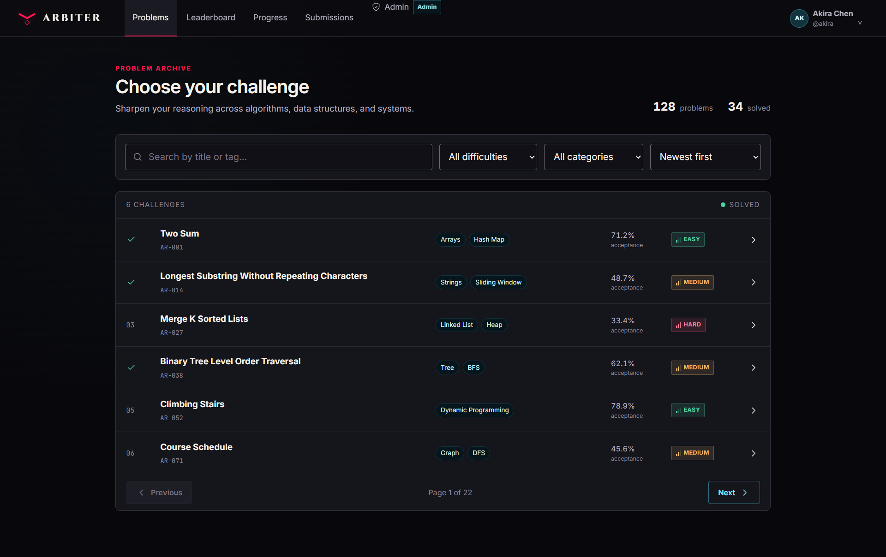

**Functions.** In addition to the shared shell functions in §12.1.1:

| Screen part | Trigger | Function |
|---|---|---|
| Problem search field | Initial, input, Enter | Set the keyword and filter the list by title or tag. Submitting an empty keyword clears the keyword condition. |
| Difficulty filter | Change | Restrict the list to `ALL`, `EASY`, `MEDIUM`, or `HARD`. |
| Category filter | Change | Restrict the list to one category or to all categories. |
| Tag filter | Change | Restrict the list to problems carrying the selected tag. |
| Sort control | Change | Reorder the list by newest, acceptance rate, or difficulty. |
| Result summary | Initial, filter change | Show the visible result count and the solved legend. |
| Problem row | Click, Enter, Space | Select the problem and open `SCR-PUB-03`. |
| Previous page | Click | Request the previous page; disabled on the first page. |
| Next page | Click | Request the next page; disabled on the last page. |
| Clear filters | Click, empty state | Reset the keyword, difficulty, category, sort, and page to their defaults. |
| Retry | Click, error state | Reissue the current search with the same criteria. |

**Field attributes.**

| Field | Length | Type | Attributes | Remarks |
|---|---|---|---|---|
| Search keyword | 0–200 | text | `E`, `OPT` | Trimmed; matches title or tag. Blank means no keyword condition. |
| Difficulty filter | — | enum | `E`, `OPT` | `ALL` by default; `EASY`, `MEDIUM`, `HARD`. |
| Category filter | 0–64 | text | `E`, `OPT` | `ALL` by default; values come from the problem catalogue. |
| Tag filter | 0–10 items; 1–32 each | array | `E`, `OPT` | Empty means all tags; values come from the problem tag catalogue. |
| Sort criterion | — | enum | `E`, `OPT` | `NEWEST` by default; `ACCEPTANCE_RATE`, `DIFFICULTY`. |
| Page | — | integer | `E`, `OPT` | One-based; default 1. Invalid values reset to page 1 under `ERR-VAL-005`. |
| Page count | — | integer | `R`, `AUTO` | Total pages for the current criteria. |
| Visible result count | — | integer | `R`, `AUTO` | Number of rows on the current page. |
| Total problem count | — | integer | `R`, `AUTO` | Header counter; reflects publicly available problems. |
| Solved count | — | integer | `R`, `AUTO` | Current user's solved count; hidden for guests. |
| Problem identifier | 36 | uuid | `R` | Rendered in the mono font. |
| Problem title | 1–200 | text | `R` | Never truncated in the row identity. |
| Difficulty | — | enum | `R`, `OPT` | Label plus the bar meter from §5.1; the badge is omitted when unset. |
| Tags | 0–10 items; 1–32 each | array | `R`, `OPT` | Chips or tags from §8.7. |
| Acceptance rate | 0–100 | decimal | `R`, `AUTO` | Percent with one decimal place. |
| Solved marker | — | boolean | `R`, `AUTO` | Check icon plus the legend; never color alone. |
| Row ordinal | — | integer | `R`, `AUTO` | Position within the current page. |

#### SCR-PUB-03 — Problem Details

**Screen specification.** Present a public problem's statement, formats, constraints, sample cases, classification, limits, supported languages, and public statistics, and provide the entry to practice.

- **Route:** `/problems/:problemID`.
- **Actors:** Guest, User, Administrator.
- **Boundary:** `ProblemBrowser.selectProblem` and `ProblemApi.getProblem`.
- **Use case trace:** `UC-COM-03`; entry to `UC-U-P-01`; exception flows in `UC-U-P-03` E3 and E4.
- **Regions:** Back action; problem identity; classification; statement; input format; output format; constraints; sample input and output; limits; supported languages; community statistics; solve action.
- **States:** Loading; guest with a sign-in solve path; authenticated user with a practice solve path; problem not found; problem not publicly accessible; rate-limited; network error.
- **Security:** Only `SAMPLE` cases may be rendered. Hidden input and expected output never appear on this screen.

**Screen image.** 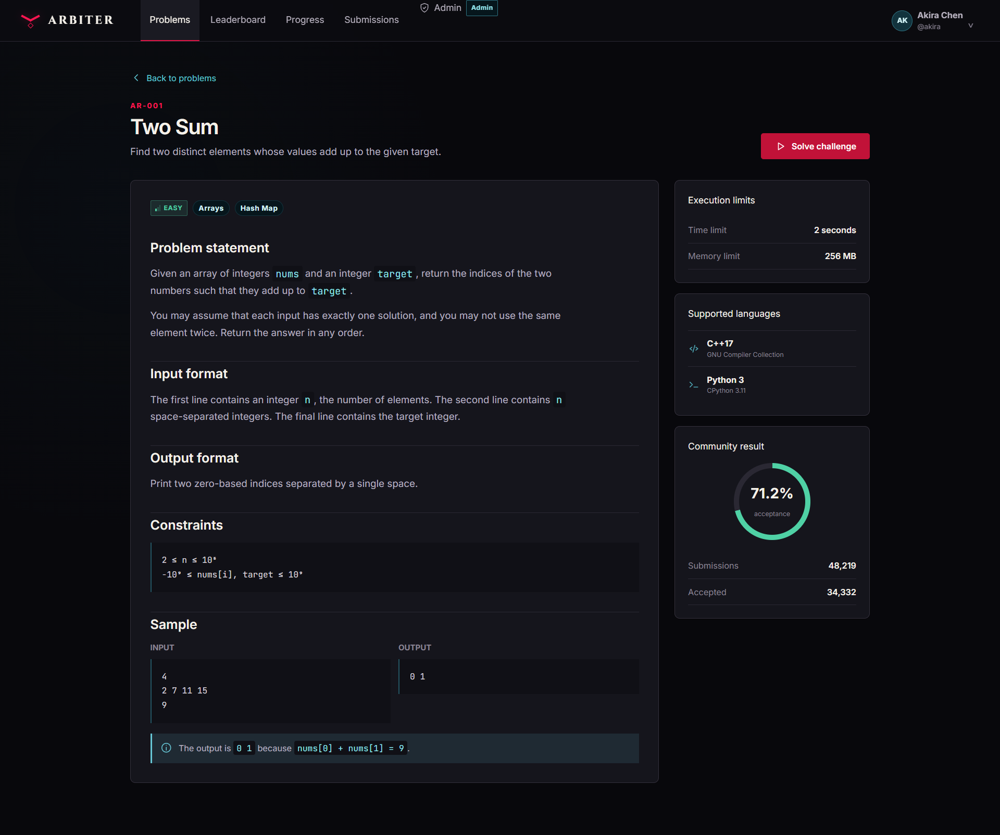

**Functions.** In addition to the shared shell functions in §12.1.1:

| Screen part | Trigger | Function |
|---|---|---|
| Back to problems | Click | Return to `SCR-PUB-02`. |
| Solve challenge | Click, authenticated | Open `SCR-PRC-01` for the displayed problem. |
| Solve challenge | Click, guest | Open `SCR-AUTH-01` and retain the practice destination for return after login. |
| Supported language row | Initial | Display the language name, runtime, and a non-interactive code icon. |
| Sample explanation note | Initial | Display the sample rationale; it is informational, not an action. |
| Retry | Click, error state | Reload the problem with the same identifier. |

**Field attributes.**

| Field | Length | Type | Attributes | Remarks |
|---|---|---|---|---|
| Problem identifier | 36 | uuid | `R` | Mono font; also used in the route. |
| Problem title | 1–200 | text | `R` | Page title. |
| Difficulty | — | enum | `R`, `OPT` | Badge and meter per §5.1; the badge is omitted when unset. |
| Tags | 0–10 items; 1–32 each | array | `R`, `OPT` | Classification chips. |
| Statement | 1–20,000 | text | `R` | Supports inline code and paragraphs; reading width applies. |
| Input format | 0–10,000 | text | `R`, `OPT` | Empty values render no section rather than an empty heading. |
| Output format | 0–10,000 | text | `R`, `OPT` | Same as input format. |
| Constraints | 0–10,000 | code | `R`, `OPT` | Monospace block; mathematical notation permitted. |
| Sample input | 0–1,048,576 B | code | `R`, `OPT` | `SAMPLE` data only. Hidden data must never be selected. |
| Sample output | 0–1,048,576 B | code | `R`, `OPT` | `SAMPLE` data only. |
| Time limit | 1–60,000 | integer | `R` | Milliseconds; displayed in seconds when exact. |
| Memory limit | 1–4,096 | integer | `R` | Megabytes. |
| Supported languages | 1–2 items | array | `R` | `CPP17` and `PYTHON3`; never empty for a published problem. |
| Submission count | 0–n | integer | `R`, `AUTO` | Public aggregate. |
| Accepted count | 0–n | integer | `R`, `AUTO` | Public aggregate; must not exceed the submission count. |
| Acceptance rate | 0–100 | decimal | `R`, `AUTO` | Percent with one decimal place. |

#### SCR-PUB-04 — Leaderboard

**Screen specification.** Display the public global ranking of active users by solved problems, with pagination and refresh.

- **Route:** `/leaderboard`.
- **Actors:** Guest, User, Administrator.
- **Boundary:** `ProgressDashboard.displayLeaderboard` with `ProgressApi.getLeaderboard`.
- **Use case trace:** `UC-COM-04`.
- **Regions:** Page header and refresh action; podium for the first three ranks; ranking table; pagination; empty state.
- **States:** Loading; populated ranking; empty ranking; page update; refresh; rate-limited; network error. The ranking must never be presented partially as complete.

**Screen image.** 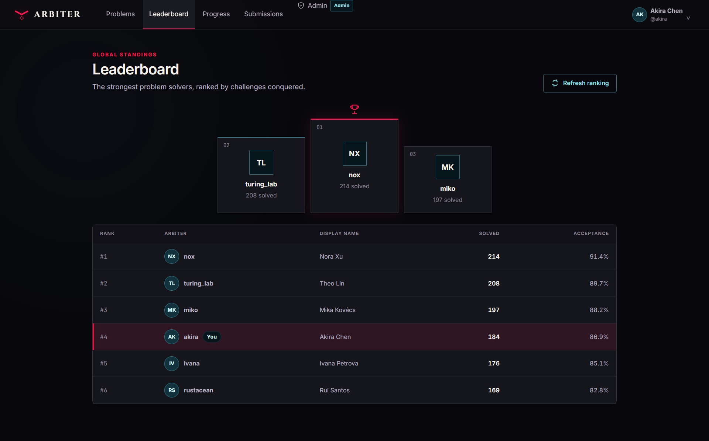

**Functions.** In addition to the shared shell functions in §12.1.1:

| Screen part | Trigger | Function |
|---|---|---|
| Refresh ranking | Click | Recalculate and reload the current page from current data. |
| Podium place | Initial | Display the first three ranks, usernames, avatars, and solved counts. |
| Ranking row | Initial | Display rank, username, display name, solved count, submission count, and acceptance rate. |
| You marker | Initial, authenticated | Identify the current user's row without hiding the row's data. |
| Previous page | Click | Request the previous page; disabled on the first page. |
| Next page | Click | Request the next page; disabled on the last page. |
| Page size control | Change | Change the number of ranking rows per page within the configured maximum. |
| Retry | Click, error state | Reissue the current page request. |

**Field attributes.**

| Field | Length | Type | Attributes | Remarks |
|---|---|---|---|---|
| Rank | — | integer | `R`, `AUTO` | Deterministic tie-break: solved descending, submissions ascending, username ascending. |
| Username | 3–32 | text | `R` | Mono or secondary text; never an email address. |
| Display name | 1–64 | text | `R` | Public profile name. |
| Solved count | 0–n | integer | `R`, `AUTO` | Distinct non-archived solved problems. |
| Submission count | 0–n | integer | `R`, `AUTO` | Required by `UC-COM-04`; displayed as a secondary metric in the ranking row. |
| Acceptance rate | 0–100 | decimal | `R`, `AUTO` | Percent with one decimal place. |
| You marker | — | boolean | `R`, `AUTO` | Text label, not color alone. |
| Avatar initials | 2 | text | `R`, `AUTO` | Decorative support for the username. |
| Page | — | integer | `E`, `OPT` | One-based; default 1. |
| Page size | — | integer | `E`, `OPT` | Default 25; permitted values 10, 25, 50, 100. |
| Total ranked users | 0–n | integer | `R`, `AUTO` | Used to calculate the page count. |

### 3.2 Authentication and account screens

#### SCR-AUTH-01 — Login

**Screen specification.** Authenticate a guest with a username or email and password and establish the session.

- **Route:** `/login`.
- **Actors:** Guest.
- **Boundary:** `AuthProvider.login` and `AccountApi.login`, hosted by `AppShell`.
- **Use case trace:** `UC-G-02`; return destination for protected-route redirects.
- **Regions:** Authentication art panel; login form; identifier field; password field; submit action; register link; validation and authentication feedback.
- **States:** Idle; submitting; invalid input; invalid credentials; account not allowed to log in; rate-limited; network or system error; session-restored redirect.

**Screen image.** 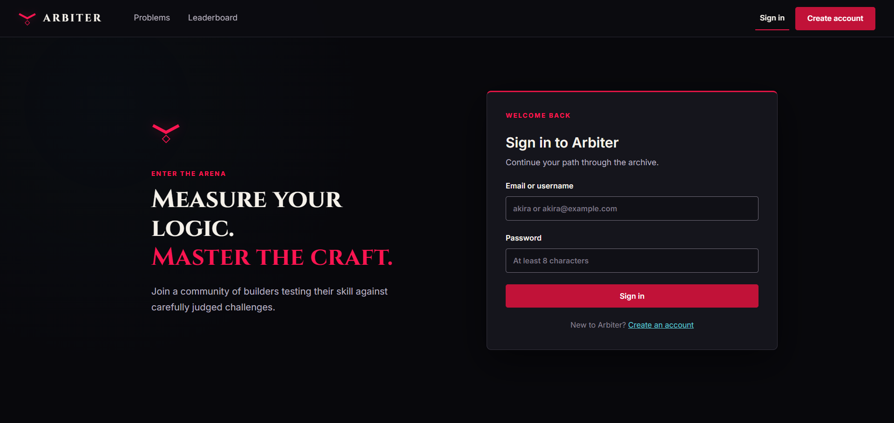

**Functions.** In addition to the shared shell functions in §12.1.1:

| Screen part | Trigger | Function |
|---|---|---|
| Sign in | Submit, Enter | Validate the fields, call `AuthProvider.login`, store the session on success, and navigate to the retained destination or `SCR-PUB-01`. |
| Create an account | Click | Open `SCR-AUTH-02`. |
| Authentication feedback | Status change | Show field errors, invalid credentials, unavailable account, rate limit, network error, or system failure per §5.4. |
| Retry | Click, recoverable error | Re-submit the same credentials only after the user confirms; never retry an authentication attempt silently. |

**Field attributes.**

| Field | Length | Type | Attributes | Remarks |
|---|---|---|---|---|
| Email or username | 1–254 | text | `E`, `REQ` | Accepts either identifier. Trimmed; case handling follows the server. |
| Password | 8–128 | password | `E`, `REQ`, `SEC` | Never prefilled or echoed. Autocomplete is `current-password`. |
| Submit state | — | boolean | `R`, `DER` | Disables duplicate submission and keeps the button labelled. |
| Retained destination | 0–2,048 | text | `HID`, `OPT` | Internal route retained by the protected-route redirect; never displayed. |
| Authentication error | — | enum | `R`, `DER` | Mapped from `ERR-VAL-003`, `ERR-AUTH-001`, `ERR-ACC-001`, and related codes. |

#### SCR-AUTH-02 — Register

**Screen specification.** Create a new account with username, email, password, and confirmation.

- **Route:** `/register`.
- **Actors:** Guest.
- **Boundary:** `AuthProvider.register` and `AccountApi.register`, hosted by `AppShell`.
- **Use case trace:** `UC-G-01`.
- **Regions:** Authentication art panel; registration form; username, email, password, and confirm-password fields; submit action; login link; post-registration confirmation.
- **States:** Idle; submitting; field validation errors; identifier already in use; rate-limited; system or network error; successful registration without an automatic session.
- **Security:** The password policy follows `FR-AUTH-12`: 8 to 128 characters with at least one letter and one digit. Helper copy must not promise a symbol requirement unless the policy requires one.

**Screen image.** 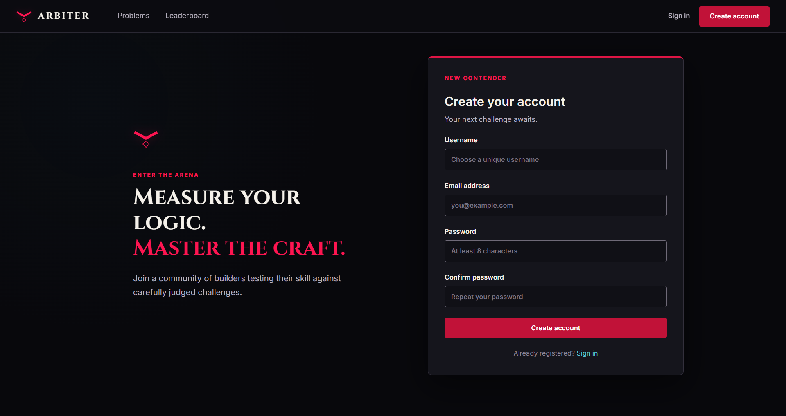

**Functions.** In addition to the shared shell functions in §12.1.1:

| Screen part | Trigger | Function |
|---|---|---|
| Create account | Submit, Enter | Validate the fields, call `AuthProvider.register`, and show the success state without creating a session. |
| Sign in | Click, form or success state | Open `SCR-AUTH-01`. |
| Continue to sign in | Click, success state | Open `SCR-AUTH-01` after registration is confirmed. |
| Registration feedback | Status change | Show field errors, duplicate username or email, rate limit, network error, or system failure. |
| Retry | Click, recoverable error | Re-submit after the user corrects the data; do not create a duplicate account on an unknown outcome. |

**Field attributes.**

| Field | Length | Type | Attributes | Remarks |
|---|---|---|---|---|
| Username | 3–32 | text | `E`, `REQ`, `UNIQ`, `IMM` | Naming convention enforced by the server; immutable after creation. |
| Email address | 3–254 | email | `E`, `REQ`, `UNIQ` | Valid address syntax; uniqueness checked before creation. |
| Password | 8–128 | password | `E`, `REQ`, `SEC` | At least one letter and one digit. Never prefilled or logged. |
| Confirm password | 8–128 | password | `E`, `REQ`, `SEC` | Must equal the password; never echoed. |
| Registration state | — | enum | `R`, `DER` | `IDLE`, `SUBMITTING`, `SUCCESS`, `ERROR`. |
| Success notice | 0–200 | text | `R`, `DER` | Confirms registration and directs the guest to sign in. Email verification is not required in v1. |

#### SCR-AUTH-03 — Account Profile

**Screen specification.** View and update the current user's own account information. Username is always immutable; display name, email, and bio are editable only in edit mode.

- **Route:** `/account`.
- **Actors:** User, Administrator.
- **Boundary:** `AppShell` child route with `AccountApi.getAccount` and `AccountApi.updateAccount`.
- **Use case trace:** `UC-U-A-02` and `UC-U-A-03`.
- **Regions:** Identity panel with avatar, display name, username, role, solved count, acceptance rate, and creation date; account information panel; view and edit modes; refresh; edit; save; cancel; change-password link.
- **States:** Loading; view mode; edit mode; refreshing; validation errors; duplicate email; account unavailable; session expired; system or network error; update success. Cancelling an edit uses an inline discard confirmation; it does not add a tenth overlay.

**Screen image.** 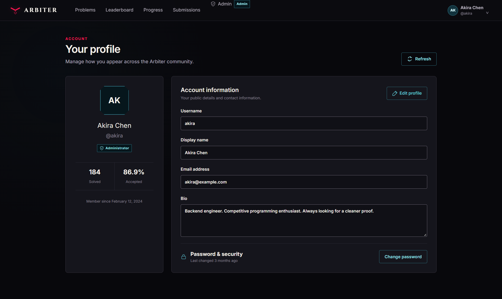

**Functions.** In addition to the shared shell functions in §12.1.1:

| Screen part | Trigger | Function |
|---|---|---|
| Refresh | Click | Reload the account information; when the form is dirty, require confirmation before discarding unsaved changes. |
| Edit profile | Click, view mode | Switch the account information panel to edit mode and focus the first editable field. |
| Save changes | Submit, edit mode | Validate and submit the changed display name, email, and bio; return to view mode on success. |
| Cancel | Click, edit mode | Discard unsaved changes after the inline discard confirmation and return to view mode. |
| Change password | Click | Open `SCR-AUTH-04`. |
| Update feedback | Status change | Show field errors, duplicate email, unavailable account, session expiry, unknown outcome, or success. |

**Field attributes.**

| Field | Length | Type | Attributes | Remarks |
|---|---|---|---|---|
| User identifier | 36 | uuid | `R` | Stable account identifier; not editable. |
| Username | 3–32 | text | `R`, `IMM` | Displayed as read-only in both modes. |
| Display name | 1–64 | text | `E`, `REQ` | Editable in edit mode only; when the account projection has no display name, the view falls back to the username. |
| Email address | 3–254 | email | `E`, `REQ`, `UNIQ` | Editable in edit mode only. |
| Bio | 0–500 | textarea | `E`, `OPT` | Editable in edit mode only; counter shown at the limit. |
| Role | — | enum | `R` | `USER` or `ADMINISTRATOR`; badge per §8.7. |
| Account status | — | enum | `R` | `ACTIVE` or `LOCKED`; read-only on this screen. |
| Account creation date | — | date | `R`, `AUTO` | Displayed as "Member since". |
| Solved count | 0–n | integer | `R`, `AUTO` | Identity panel statistic. |
| Acceptance rate | 0–100 | decimal | `R`, `AUTO` | Identity panel statistic. |
| Last password change | — | datetime | `R`, `AUTO` | May be shown as a relative time. |
| Form mode | — | enum | `HID` | `VIEW` or `EDIT`; controls editability. |
| Unsaved changes | — | boolean | `HID` | Enables the inline discard confirmation. |

#### SCR-AUTH-04 — Change Password

**Screen specification.** Change the current user's password by supplying the current password and a new password.

- **Route:** `/account/password`.
- **Actors:** User, Administrator.
- **Boundary:** `AppShell` child route with `AccountApi.changePassword`; session clearing through `AuthProvider` after success.
- **Use case trace:** `UC-U-A-04`.
- **Regions:** Back-to-profile action; security notice; current-password field; new-password field; confirm-new-password field; cancel and update actions.
- **States:** Idle; submitting; incorrect current password; invalid new password; new password equal to the current password; account unavailable; session expired; rate-limited; system or network error; success.
- **Security:** Passwords are never echoed, logged, or retained after the operation.

**Screen image.** 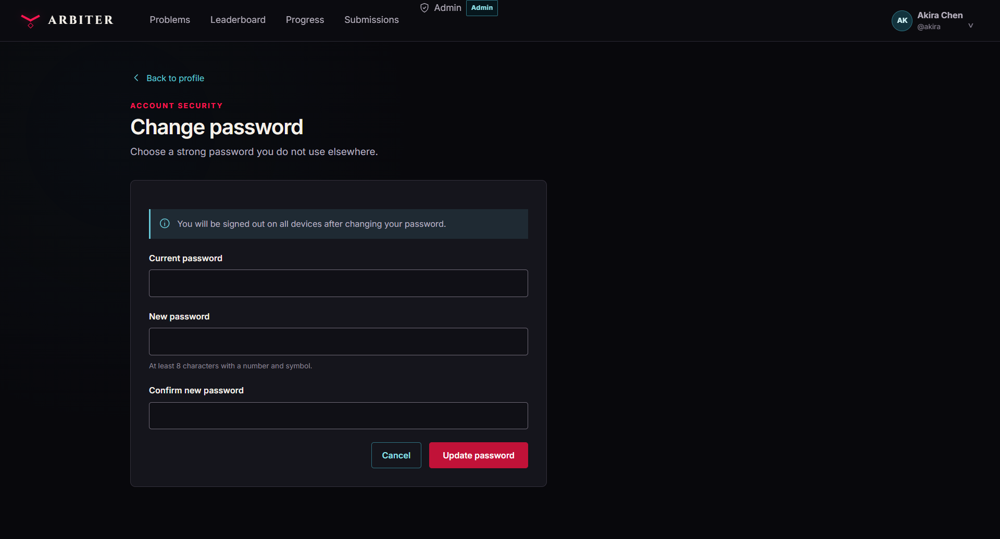

**Functions.** In addition to the shared shell functions in §12.1.1:

| Screen part | Trigger | Function |
|---|---|---|
| Back to profile | Click | Return to `SCR-AUTH-03` without changing the password. |
| Cancel | Click | Discard the entered values and return to `SCR-AUTH-03`. |
| Update password | Submit, Enter | Validate the fields, call `AccountApi.changePassword`, and on success clear the session and open `SCR-AUTH-01`. |
| Password policy note | Initial | Explain the current policy and the sign-out consequence. |
| Change feedback | Status change | Show incorrect current password, invalid new password, same-as-current rejection, rate limit, unknown outcome, or success. |

**Field attributes.**

| Field | Length | Type | Attributes | Remarks |
|---|---|---|---|---|
| Current password | 8–128 | password | `E`, `REQ`, `SEC` | Never prefilled or echoed. |
| New password | 8–128 | password | `E`, `REQ`, `SEC` | At least one letter and one digit; must differ from the current password. |
| Confirm new password | 8–128 | password | `E`, `REQ`, `SEC` | Must equal the new password; never echoed. |
| Password policy | 0–200 | text | `R`, `AUTO` | Helper copy; must match the enforced policy. |
| Submit state | — | boolean | `R`, `DER` | Disables duplicate submission and keeps the button labelled. |
| Sign-out consequence | — | boolean | `R`, `AUTO` | Always true after a successful change in v1. |

### 3.3 Practice, submission, and progress screens

#### SCR-PRC-01 — Practice Workspace

**Screen specification.** Write and edit a solution, select a supported language, and submit the solution for judging.

- **Route:** `/practice/:problemID`.
- **Actors:** User, Administrator.
- **Boundary:** `PracticeWorkspace` with `ProblemApi.getEditorContext` and `SubmissionApi.createSubmission`.
- **Use case trace:** `UC-U-P-01`, `UC-U-P-02`, and `UC-U-P-03`.
- **Regions:** Problem context bar with identifier, difficulty, title, limits, and history action; description tab; language selector; restore and clear actions; source editor; source metrics; submit action; submission receipt.
- **States:** Editor initializing; initialization error; unsupported language; editing; empty source; source over 64 KiB; submitting; validation errors; rate-limited; unknown network outcome; problem not found or not public; session expired.
- **Security:** Only the current user's draft is present. A reserved reference tab, if shown, must not expose other users' source code or hidden test data.

**Screen image.** 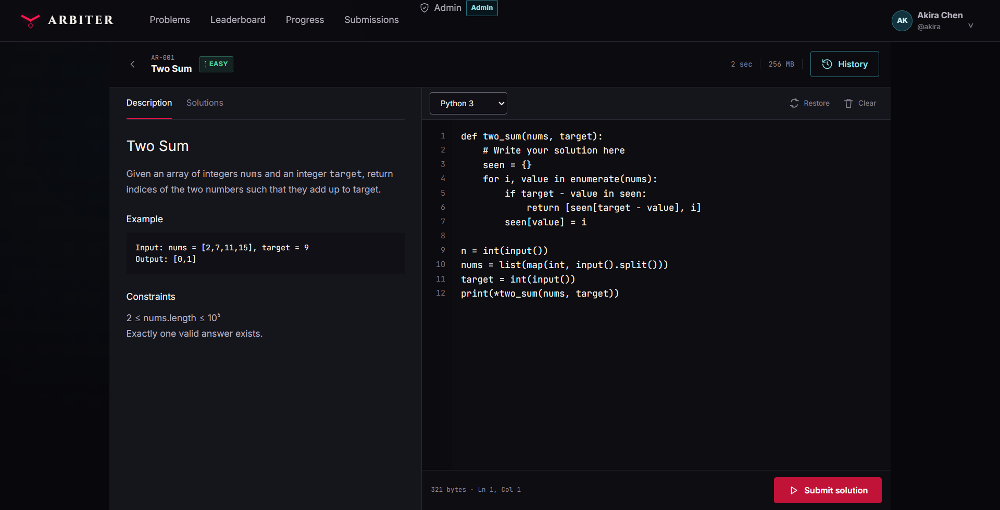

**Functions.** In addition to the shared shell functions in §12.1.1:

| Screen part | Trigger | Function |
|---|---|---|
| Problem context | Click, title area | Return to `SCR-PUB-03` for the displayed problem. |
| History | Click | Open `SCR-SUB-02` filtered to the current problem where the query supports it. |
| Description tab | Click | Show the problem statement, sample, and constraints inside the workspace. |
| Solutions tab | Click | Switch to the reserved reference panel. If the panel is not enabled in v1, keep the tab disabled with an explanation; never render other users' source code. |
| Language selector | Initial, change | Set `CPP17` or `PYTHON3`, validate support, and apply the corresponding editor configuration. Reselecting the current language is a no-op. |
| Restore | Click | Open `DLG-PRC-02`; confirmation replaces the source with the selected language's template. |
| Clear | Click | Open `DLG-PRC-01`; confirmation clears the editor source. |
| Source editor | Input, paste, keyboard | Edit `draft.source` with syntax highlighting, line numbers, indentation, and code navigation. |
| Source metrics | Input, cursor move | Show byte count, cursor line, and cursor column. |
| Submit solution | Click | Validate language, source, and the 64 KiB limit; call `SubmissionApi.createSubmission`; show the receipt on acceptance. |
| Receipt link | Click, accepted | Open `SCR-SUB-01` for the new submission identifier. |
| Draft retention | Route change or session restore | Retain the draft for the session according to `UC-U-P-03` A1. |
| Retry | Click, recoverable error | Re-submit only after the user verifies an unknown outcome, or reinitialize the editor after an initialization error. |

**Field attributes.**

| Field | Length | Type | Attributes | Remarks |
|---|---|---|---|---|
| Problem identifier | 36 | uuid | `R` | Context from the route. |
| Problem title | 1–200 | text | `R` | Context bar. |
| Difficulty | — | enum | `R`, `OPT` | Badge per §5.1; the badge is omitted when unset. |
| Time limit | 1–60,000 | integer | `R` | Milliseconds; displayed in seconds when exact. |
| Memory limit | 1–4,096 | integer | `R` | Megabytes. |
| Supported languages | 1–2 items | array | `R` | Selector values are limited to this list. |
| Selected language | — | enum | `E`, `REQ` | `CPP17` or `PYTHON3`; default from the problem context. |
| Source code | 0–65,536 B | code | `E`, `REQ` | Non-empty at submission; the client limit matches `FR-SUB-05`. |
| Source byte count | 0–65,536 | integer | `R`, `DER` | Updates as the source changes. |
| Cursor line | 1–n | integer | `R`, `DER` | One-based. |
| Cursor column | 1–n | integer | `R`, `DER` | One-based. |
| Editor configuration | — | object | `HID`, `AUTO` | Language, highlighting, indentation, and template selection. |
| Draft session key | 0–128 | text | `HID` | Browser-session retention key; never displayed. |
| Submission identifier | 36 | uuid | `R`, `AUTO` | Receipt after acceptance. |
| Receipt status | — | enum | `R`, `AUTO` | `QUEUED` at receipt. |
| Submission language | — | enum | `R`, `AUTO` | Echo of the selected language. |
| Submission state | — | enum | `R`, `DER` | `IDLE`, `SUBMITTING`, `ACCEPTED`, `UNKNOWN`, `ERROR`. |

#### SCR-SUB-01 — Submission Status

**Screen specification.** Monitor a submission's current state and timestamps until it reaches a terminal state, then lead to the result.

- **Route:** `/submissions/:submissionID/status`.
- **Actors:** User, Administrator.
- **Boundary:** `SubmissionTracker` with `usePolling` and `SubmissionApi.getSubmissionStatus`.
- **Use case trace:** `UC-U-S-01`.
- **Regions:** Back-to-history action; submission identity; status badge; current-state message; status timeline; problem, language, and timestamps; polling notice; result action.
- **States:** Loading; `QUEUED`; `COMPILING`; `RUNNING`; `COMPLETED` with result action; `INTERNAL_ERROR` as a system failure; paused or stopped polling; recoverable polling failure with retry; unknown network outcome; rate-limited; not found; not owned by the user.
- **Presentation:** `INTERNAL_ERROR` is never shown as a verdict and never offered as a valid grading outcome.

**Screen image.** In-progress state: 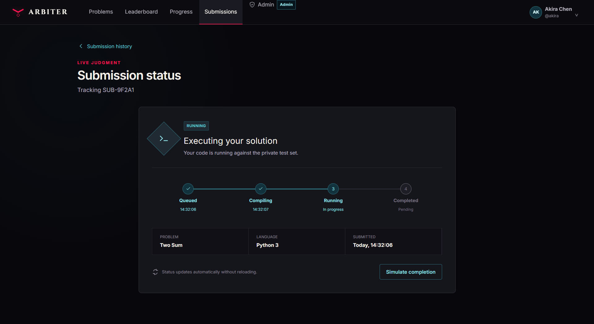

Terminal state: 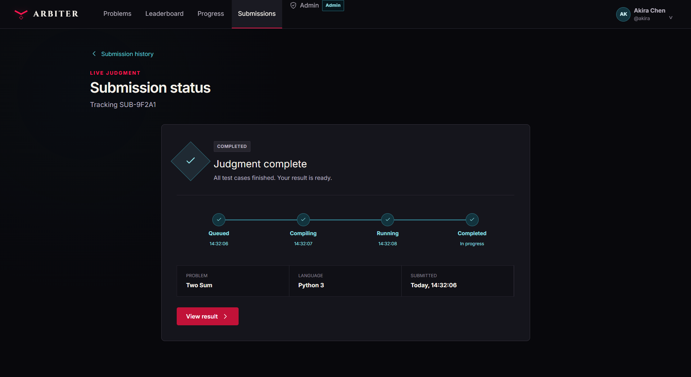

**Functions.** In addition to the shared shell functions in §12.1.1:

| Screen part | Trigger | Function |
|---|---|---|
| Back to submission history | Click | Open `SCR-SUB-02`. |
| Status polling | Initial, interval | Request the current status at the configured interval with backoff; update the screen without a page reload. |
| Polling pause | Visibility change or navigation away | Pause or stop polling so hidden views do not continue network work. |
| Polling resume | Visibility return | Resume polling only while the submission is non-terminal. |
| Status timeline | Status change | Advance `QUEUED`, `COMPILING`, `RUNNING`, and `COMPLETED` steps with timestamps. |
| View result | Click, `COMPLETED` | Open the result section of `SCR-SUB-03` at `/submissions/:submissionID/result`. |
| Retry | Click, recoverable failure | Reissue the status request; do not claim success or failure. |
| Terminal stop | Status change | Stop polling on `COMPLETED` or `INTERNAL_ERROR`. |
| System-failure explanation | `INTERNAL_ERROR` | Explain that a trustworthy result could not be produced and offer the history path. |

**Field attributes.**

| Field | Length | Type | Attributes | Remarks |
|---|---|---|---|---|
| Submission identifier | 36 | uuid | `R` | Mono font; used in the route. |
| Problem title | 1–200 | text | `R` | Retained problem summary. |
| Language | — | enum | `R` | `CPP17` or `PYTHON3`. |
| Current status | — | enum | `R`, `AUTO` | `QUEUED`, `COMPILING`, `RUNNING`, `COMPLETED`, `INTERNAL_ERROR`. |
| Status message | 0–200 | text | `R`, `DER` | Short, non-verdict description of the current state. |
| Created time | — | datetime | `R`, `AUTO` | Submission creation time. |
| Started time | — | datetime | `R`, `AUTO`, `OPT` | Empty until judging begins. |
| Completed time | — | datetime | `R`, `AUTO`, `OPT` | Empty until a terminal state is reached. |
| Timeline step | — | enum | `R`, `DER` | Completed, current, pending, or failed presentation. |
| Polling state | — | enum | `R`, `DER` | `ACTIVE`, `PAUSED`, `RETRYING`, `STOPPED`. |
| Retry after | — | datetime | `R`, `AUTO`, `OPT` | Present only for a rate-limit or recoverable failure. |
| Result available | — | boolean | `R`, `DER` | True only for `COMPLETED`. |
| Terminal state | — | boolean | `R`, `DER` | True for `COMPLETED` and `INTERNAL_ERROR`. |

#### SCR-SUB-02 — Submission History

**Screen specification.** Browse the current user's submissions in newest-first order and open one for details or status.

- **Route:** `/submissions`.
- **Actors:** User, Administrator.
- **Boundary:** `SubmissionBrowser` with `SubmissionApi.getSubmissionHistory`.
- **Use case trace:** `UC-U-S-03`.
- **Regions:** Search field; problem filter; verdict filter; history table; empty state; pagination; page-size control.
- **States:** Loading; populated history; no submissions; non-terminal rows without verdicts; `INTERNAL_ERROR` as a system-failure status; invalid pagination recovery; rate-limited; network error.
- **Presentation:** A verdict is shown only when the status is `COMPLETED`. `INTERNAL_ERROR` uses the system-failure treatment, never the verdict badge slot.

**Screen image.** 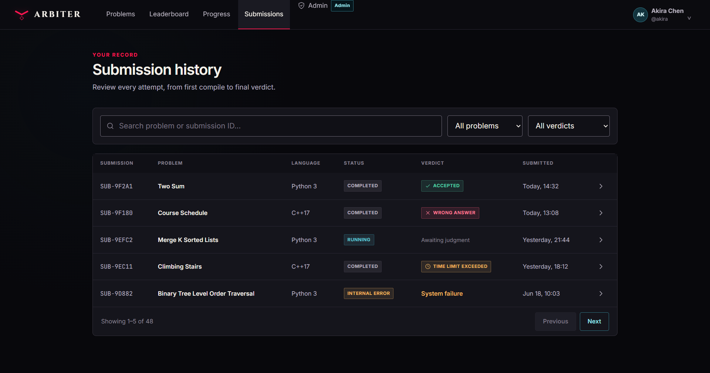

**Functions.** In addition to the shared shell functions in §12.1.1:

| Screen part | Trigger | Function |
|---|---|---|
| Search field | Initial, input, Enter | Filter the history by problem title or submission identifier. |
| Problem filter | Change | Restrict the history to one problem or to all problems. |
| Verdict filter | Change | Restrict by verdict or status, including `ALL`; `INTERNAL_ERROR` is not offered as a verdict. |
| History row | Click, Enter, Space | Open `SCR-SUB-03` for a completed submission or `SCR-SUB-01` for a non-terminal submission. |
| Previous page | Click | Request the previous page; disabled on the first page. |
| Next page | Click | Request the next page; disabled on the last page. |
| Page size control | Change | Change the number of rows per page within the configured maximum. |
| Clear filters | Click, empty state | Reset the search and filters to their defaults. |
| Retry | Click, error state | Reissue the current history query. |

**Field attributes.**

| Field | Length | Type | Attributes | Remarks |
|---|---|---|---|---|
| Search keyword | 0–200 | text | `E`, `OPT` | Matches problem title or submission identifier. |
| Problem filter | 0–200 | text | `E`, `OPT` | `ALL` by default; values come from the user's submission history. |
| Verdict filter | — | enum | `E`, `OPT` | `ALL` by default; `ACCEPTED`, `WRONG_ANSWER`, `TIME_LIMIT_EXCEEDED`, `MEMORY_LIMIT_EXCEEDED`, `RUNTIME_ERROR`, `COMPILATION_ERROR`. |
| Page | — | integer | `E`, `OPT` | One-based; default 1. |
| Page size | — | enum | `E`, `OPT` | 10, 25, 50, or 100; default 25. |
| Total submission count | 0–n | integer | `R`, `AUTO` | Used for the paging summary. |
| Submission identifier | 36 | uuid | `R` | Mono font. |
| Problem title | 1–200 | text | `R` | Row identity. |
| Language | — | enum | `R` | `CPP17` or `PYTHON3`. |
| Status | — | enum | `R` | Status badge per §5.2. |
| Verdict | — | enum | `R`, `OPT`, `AUTO` | Present only for `COMPLETED`; badge per §5.3. |
| Submitted time | — | datetime | `R` | Displayed in a consistent local format. |
| System-failure marker | — | boolean | `R`, `DER` | True for `INTERNAL_ERROR`; renders as "System failure", not a verdict. |

#### SCR-SUB-03 — Submission Details and Result

**Screen specification.** Show the source code, status, and, when available, the verdict, execution metrics, compilation information, and executed-case summary for one of the current user's submissions in read-only mode.

- **Route:** `/submissions/:submissionID`; result section deep link `/submissions/:submissionID/result`.
- **Actors:** User, Administrator.
- **Boundary:** `SubmissionBrowser` with `SubmissionApi.getSubmissionDetails` and `SubmissionApi.getSubmissionResult`.
- **Use case trace:** `UC-U-S-04` and `UC-U-S-02`.
- **Regions:** Back-to-history action; submission identity; result summary; source code panel; executed cases panel; compilation output; status link for non-terminal submissions; open-in-editor action.
- **States:** Loading; queued or judging with source and current status but no verdict; completed with result; internal error with source and system-failure explanation; problem no longer public but summary retained; not found; not owned; rate-limited; network error.
- **Security:** Hidden test-case inputs and expected outputs are never rendered. Per-case rows never include hidden input or expected output. `INTERNAL_ERROR` is never displayed as a verdict.

**Screen image.** 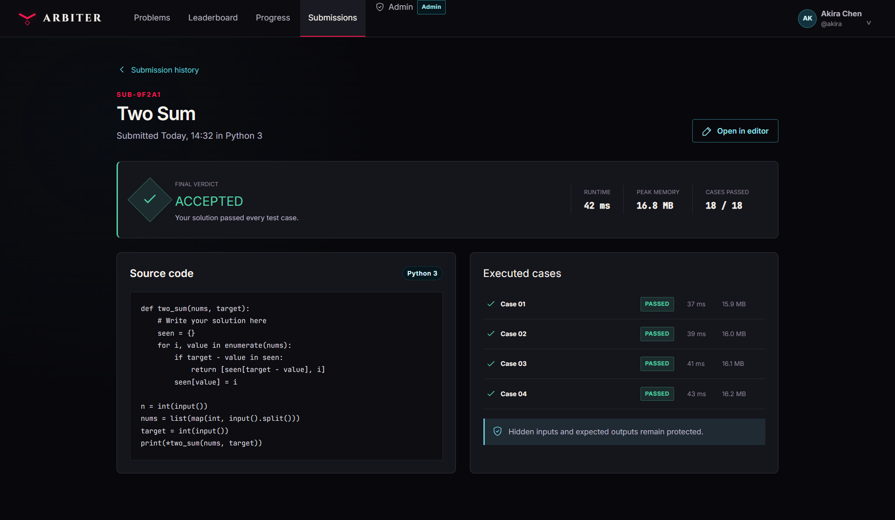

**Functions.** In addition to the shared shell functions in §12.1.1:

| Screen part | Trigger | Function |
|---|---|---|
| Back to submission history | Click | Return to `SCR-SUB-02`. |
| Open in editor | Click | Open `SCR-PRC-01` for the related problem, primarily after a compilation error. |
| View status | Click, non-terminal | Open `SCR-SUB-01` for the same submission. |
| Result section | Initial, deep link, click | Show the verdict, metrics, compilation output, and executed cases; the deep link selects this section. |
| Compilation output disclosure | Click | Expand or collapse the bounded, user-safe compiler output. |
| Executed case row | Initial | Display case identifier, outcome, runtime, memory, and a user-safe message without hidden data. |
| Retry | Click, error state | Reload the submission details or result. |

**Field attributes.**

| Field | Length | Type | Attributes | Remarks |
|---|---|---|---|---|
| Submission identifier | 36 | uuid | `R` | Mono font; used in the route. |
| Problem title | 1–200 | text | `R` | Retained summary. |
| Language | — | enum | `R` | `CPP17` or `PYTHON3`. |
| Submitted time | — | datetime | `R` | Displayed in a consistent local format. |
| Source code | 0–65,536 B | code | `R` | Read-only; never editable here. |
| Status | — | enum | `R` | Status badge per §5.2. |
| Verdict | — | enum | `R`, `OPT` | Present only for `COMPLETED`; `INTERNAL_ERROR` is never a verdict. |
| Runtime | 0–n | integer | `R`, `AUTO` | Milliseconds; aggregate for the submission. |
| Peak memory | 0–n | decimal | `R`, `AUTO` | Megabytes, converted from kilobytes where needed. |
| Cases passed | 0–n | integer | `R`, `AUTO` | Count of passed executed cases. |
| Total cases | 0–n | integer | `R`, `AUTO` | Count of executed cases. |
| Compilation output | 0–16,384 B | text | `R`, `OPT` | Bounded and user-safe; shown for `COMPILATION_ERROR`. |
| Case identifier | 36 | uuid | `R` | Historical identifier, not a link to test-case data. |
| Case outcome | — | enum | `R` | `PASSED`, `FAILED`, `SKIPPED`. |
| Case runtime | 0–n | integer | `R`, `AUTO` | Milliseconds. |
| Case memory | 0–n | decimal | `R`, `AUTO` | Megabytes. |
| Case message | 0–500 | text | `R`, `OPT` | Must not contain hidden input or expected output. |
| Result section selected | — | boolean | `HID`, `DER` | True when the deep link selects the result section. |

#### SCR-PRG-01 — Progress Dashboard

**Screen specification.** Show the current user's attempted and solved problems, acceptance rate, breakdowns, and the ten most recent submissions.

- **Route:** `/progress`.
- **Actors:** User, Administrator.
- **Boundary:** `ProgressDashboard` with `ProgressApi.getOwnStatistics`.
- **Use case trace:** `UC-U-ST-01`.
- **Regions:** Summary statistic cards; difficulty breakdown; strongest domains; ten most recent submissions; empty state; refresh action.
- **States:** Loading; populated statistics; empty state inviting the user to solve a problem; refreshing; session expired; account unavailable; rate-limited; network or system error.

**Screen image.** 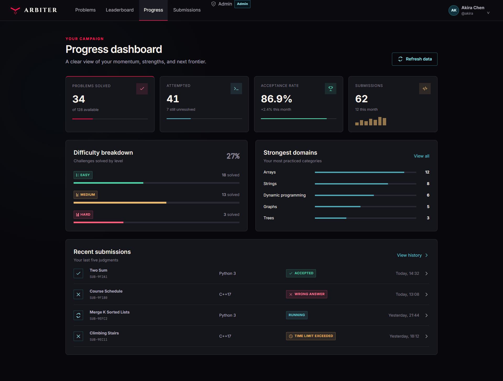

**Functions.** In addition to the shared shell functions in §12.1.1:

| Screen part | Trigger | Function |
|---|---|---|
| Refresh data | Click | Reload the statistics and recent submissions without leaving the screen. |
| View all domains | Click | Expand the domain list when more categories exist than are shown by default. |
| View history | Click | Open `SCR-SUB-02`. |
| Recent submission row | Click | Open `SCR-SUB-03` for a completed submission or `SCR-SUB-01` for a non-terminal submission. |
| Empty-state action | Click, empty statistics | Open `SCR-PUB-02` to start solving. |
| Retry | Click, error state | Reload the statistics request. |

**Field attributes.**

| Field | Length | Type | Attributes | Remarks |
|---|---|---|---|---|
| Solved count | 0–n | integer | `R`, `AUTO` | Distinct solved problems. |
| Attempted count | 0–n | integer | `R`, `AUTO` | Distinct attempted problems. |
| Acceptance rate | 0–100 | decimal | `R`, `AUTO` | Percent with one decimal place. |
| Submission count | 0–n | integer | `R`, `AUTO` | Total submissions. |
| Available problem count | 0–n | integer | `R`, `AUTO` | Denominator for the solved progress. |
| Month delta | −100–100 | decimal | `R`, `AUTO` | Change in acceptance rate for the current month. |
| Difficulty breakdown | 3 items | array | `R`, `AUTO` | `EASY`, `MEDIUM`, `HARD` counts. |
| Domain count | 0–n | integer | `R`, `AUTO` | Solved count per tag or category. |
| Recent problem title | 1–200 | text | `R` | Recent submission row. |
| Recent submission identifier | 36 | uuid | `R` | Recent submission row; mono font. |
| Recent language | — | enum | `R` | `CPP17` or `PYTHON3`. |
| Recent verdict or status | — | enum | `R` | Verdict only for `COMPLETED`; status otherwise. |
| Recent created time | — | datetime | `R` | Recent submission row. |

### 3.4 Administration screens

#### SCR-ADM-01 — Problem Management

**Screen specification.** Serve as the administrator entry point for problem lifecycle, publication, metadata editing, and test-case management.

- **Route:** `/admin/problems`.
- **Actors:** Administrator.
- **Boundary:** `AdminConsole` with `ProblemApi.listProblems` and `ProblemApi.getProblem`.
- **Use case trace:** `UC-AD-P-01` to `UC-AD-P-04`; entry to `UC-AD-T-01` to `UC-AD-T-05`.
- **Regions:** Administrator workspace banner; search and state filter; problem list; selected-problem panel; create, edit, manage-test-cases, publication, and lifecycle actions; notifications.
- **States:** Loading; populated or empty list; selected problem active or inactive; draft or published; stale-version conflict; publication requirements unmet; success; system or network error.
- **Test-case precondition:** Manage test cases is enabled only while the selected problem is `ACTIVE` and `DRAFT`; otherwise it is disabled with an explanation.

**Screen image.** 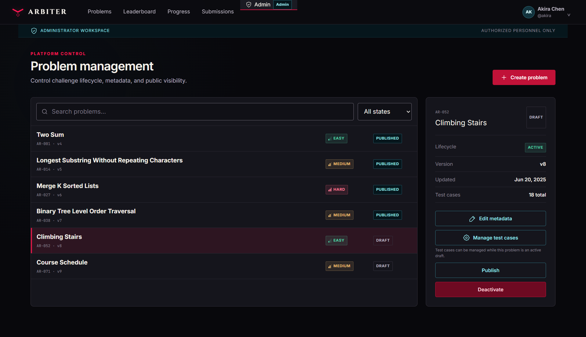

**Functions.** In addition to the shared shell functions in §12.1.1:

| Screen part | Trigger | Function |
|---|---|---|
| Create problem | Click | Open `SCR-ADM-02` in create mode. |
| Search problems | Initial, input, Enter | Filter the list by problem title or identifier. |
| State filter | Change | Restrict the list by lifecycle, publication, or a combined state. |
| Problem row | Click, Enter, Space | Select the problem and populate the selected-problem panel. |
| Edit metadata | Click | Open `SCR-ADM-02` in edit mode for the selected problem and version. |
| Manage test cases | Click | Open `SCR-ADM-03`; enabled only for an active draft problem. |
| Publish or unpublish | Click | Open `DLG-ADM-02`; confirmation applies the publication change or explains unmet requirements. |
| Deactivate or activate | Click | Open `DLG-ADM-01`; confirmation applies the lifecycle change and preserves submissions. |
| Reload or verify | Click, conflict state | Reload the latest problem version before retrying a stale mutation. |
| Retry | Click, error state | Reissue the list or selected-problem read. |

**Field attributes.**

| Field | Length | Type | Attributes | Remarks |
|---|---|---|---|---|
| Search keyword | 0–200 | text | `E`, `OPT` | Matches title or identifier. |
| State filter | — | enum | `E`, `OPT` | `ALL` by default; `ACTIVE`, `INACTIVE`, `DRAFT`, `PUBLISHED`. |
| Problem identifier | 36 | uuid | `R` | Mono font. |
| Problem title | 1–200 | text | `R` | Row identity. |
| Difficulty | — | enum | `R`, `OPT` | Badge per §5.1. |
| Lifecycle status | — | enum | `R` | `ACTIVE` or `INACTIVE`. |
| Publication status | — | enum | `R` | `DRAFT` or `PUBLISHED`. |
| Version | 1–n | integer | `R`, `CONC` | Shown as `vN`; retained for the next mutation. |
| Updated time | — | datetime | `R`, `AUTO` | Last problem update. |
| Test case count | 0–n | integer | `R`, `AUTO` | Total cases in the set. |
| Selected problem | — | boolean | `DER` | Controls the detail panel and action state. |
| Action availability | — | enum | `R`, `DER` | Explains why manage-test-cases, publish, or lifecycle actions are disabled. |

#### SCR-ADM-02 — Problem Form

**Screen specification.** Create a problem or update an existing problem's metadata in a single form with create and edit modes.

- **Route:** `/admin/problems/new` and `/admin/problems/:problemID/edit`.
- **Actors:** Administrator.
- **Boundary:** `AdminConsole` with `ProblemApi.createProblem` and `ProblemApi.updateProblem`.
- **Use case trace:** `UC-AD-P-01` and `UC-AD-P-02`.
- **Regions:** Challenge identity section; problem specification section; execution limits section; mode-specific actions; validation feedback; unsaved-changes guard.
- **States:** Idle; editing; submitting; field validation errors; inactive problem rejection in edit mode; concurrent-update conflict; unsaved-changes confirmation; success; system or network error.

**Screen image.** 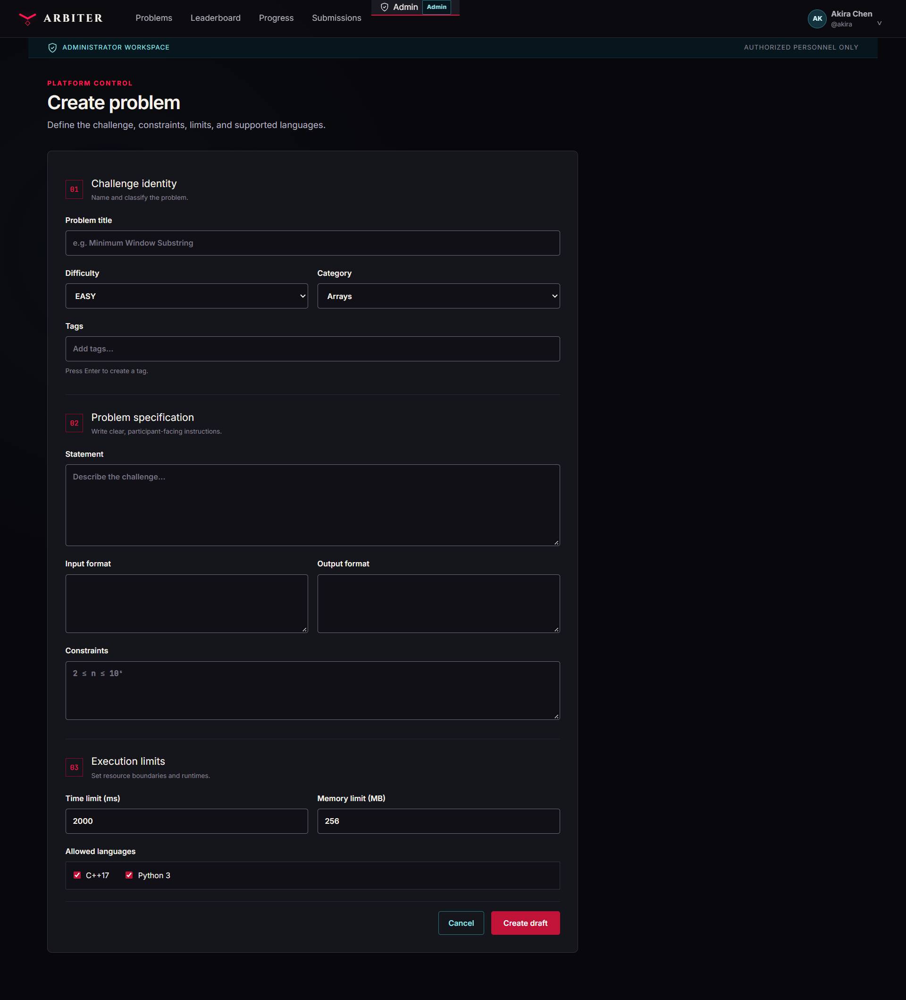

**Functions.** In addition to the shared shell functions in §12.1.1:

| Screen part | Trigger | Function |
|---|---|---|
| Create draft or Save changes | Submit | Validate the form and call the create or update operation with the retained version in edit mode. |
| Create another | Click, create mode | Save the current draft and reset the form for a new problem. |
| Cancel | Click | Return to `SCR-ADM-01`; if the form is dirty, open `DLG-ADM-06` first. |
| Add tag | Enter in the tag field | Create a tag chip from the trimmed value when it is within limits. |
| Remove tag | Click a tag chip | Remove the tag from the draft. |
| Difficulty selector | Change | Set `EASY`, `MEDIUM`, or `HARD`. |
| Category selector | Change | Set or clear the problem category. |
| Allowed language checkbox | Change | Add or remove `CPP17` or `PYTHON3` from the allowed set. |
| Manage test cases | Click, post-create success | Open `SCR-ADM-03` for the newly created problem. |
| Open saved problem | Click, success state | Open `SCR-ADM-01` with the saved problem selected. |
| Reload or verify | Click, conflict state | Reload the latest problem and require the administrator to reapply changes. |
| Retry | Click, error state | Re-submit only after the outcome is known or the resource is verified. |

**Field attributes.**

| Field | Length | Type | Attributes | Remarks |
|---|---|---|---|---|
| Problem title | 1–200 | text | `E`, `REQ` | Required for creation and publication. |
| Statement | 1–20,000 | textarea | `E`, `REQ` | Required for creation and publication. |
| Input format | 0–10,000 | textarea | `E`, `OPT` | Empty values are permitted. |
| Output format | 0–10,000 | textarea | `E`, `OPT` | Empty values are permitted. |
| Constraints | 0–10,000 | textarea | `E`, `OPT` | Monospace textarea. |
| Difficulty | — | enum | `E`, `OPT` | `EASY`, `MEDIUM`, `HARD`; default `EASY`. |
| Category | 0–64 | text | `E`, `OPT` | Single category. |
| Tags | 0–10 items; 1–32 each | array | `E`, `OPT` | Create on Enter; duplicate tags are rejected. |
| Time limit | 1–60,000 | integer | `E`, `REQ` | Milliseconds; positive; default 1,000. |
| Memory limit | 1–4,096 | integer | `E`, `REQ` | Megabytes; positive; default 256. |
| Allowed languages | 1–2 items | array | `E`, `REQ` | `CPP17` and `PYTHON3`; at least one is required. |
| Version | 1–n | integer | `R`, `CONC` | Present in edit mode only. |
| Form mode | — | enum | `HID` | `CREATE` or `EDIT`. |
| Unsaved changes | — | boolean | `HID` | Enables `DLG-ADM-06`. |
| Validation summary | 0–n | array | `R`, `DER` | Field-level errors mapped back to the controls. |

#### SCR-ADM-03 — Test Case Management

**Screen specification.** List a problem's ordered test cases and provide create, edit, delete, type-change, and reorder operations.

- **Route:** `/admin/problems/:problemID/test-cases`.
- **Actors:** Administrator.
- **Boundary:** `AdminConsole` with `TestCaseApi.listTestCases` and the test-case mutation operations.
- **Use case trace:** `UC-AD-T-01` to `UC-AD-T-05`.
- **Regions:** Problem context and draft version; confidentiality banner; ordered case table; drag or move controls; per-row edit, type-change, and delete actions; save-order and cancel-order actions; publication-readiness warning.
- **States:** Loading; ordered list; empty case set; reordering in progress; unsaved local order; duplicate order; stale set version; problem no longer active and draft; success notifications.
- **Security:** Hidden input and expected output are visible in this authorized administrative view and in `SCR-ADM-04`; they remain excluded from all participant-facing screens and from `SCR-ADM-06`.

**Screen image.** 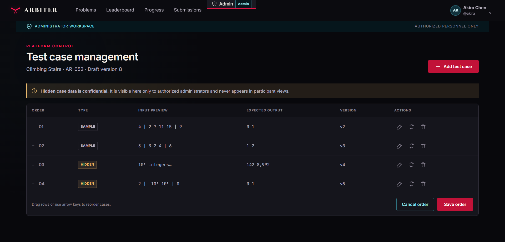

**Functions.** In addition to the shared shell functions in §12.1.1:

| Screen part | Trigger | Function |
|---|---|---|
| Add test case | Click | Open `SCR-ADM-04` in create mode with the next ordinal suggested. |
| Drag handle | Drag, keyboard move | Change the local execution order without sending a request. |
| Move up or move down | Click or keyboard | Move the row one position locally. |
| Edit | Click | Open `SCR-ADM-04` in edit mode with the case version. |
| Change type | Click | Open `DLG-ADM-04`; confirmation changes `SAMPLE` or `HIDDEN`. Selecting the current type sends no request. |
| Delete | Click | Open `DLG-ADM-03`; confirmation deletes the case and refreshes ordinals. |
| Save order | Click | Send the complete ordered identifier list and the set version. |
| Cancel order | Click | Discard the local order and reload the persisted order; send no request. |
| Back to problems | Click | Return to `SCR-ADM-01` with the problem selected. |
| Retry | Click, error state | Reload the ordered list or the persisted set version. |

**Field attributes.**

| Field | Length | Type | Attributes | Remarks |
|---|---|---|---|---|
| Problem identifier | 36 | uuid | `R` | Context; not editable. |
| Problem title | 1–200 | text | `R` | Context. |
| Draft version | 1–n | integer | `R`, `CONC` | Problem version shown in the context. |
| Set version | 1–n | integer | `R`, `CONC`, `HID` | Required for reorder; not user-editable. |
| Ordinal | 1–10,000 | integer | `R`, `DER` | One-based position; recalculated after a successful reorder. |
| Type | — | enum | `R` | `SAMPLE` or `HIDDEN`; changed through `DLG-ADM-04`. |
| Input preview | 0–200 | text | `R`, `DER` | Truncated display; full data is available in `SCR-ADM-04`. |
| Expected output preview | 0–200 | text | `R`, `DER` | Truncated display; full data is available in `SCR-ADM-04`. |
| Case version | 1–n | integer | `R`, `CONC` | Per-case concurrency token. |
| Local order dirty | — | boolean | `DER` | Enables save-order and cancel-order. |
| Publication readiness | — | enum | `R`, `DER` | Warns when the set lacks a sample or hidden case. |
| Test case count | 0–n | integer | `R`, `AUTO` | Total cases in the set. |

#### SCR-ADM-04 — Test Case Form

**Screen specification.** Create or update the input data, expected output, type, and execution order of a test case.

- **Route:** `/admin/problems/:problemID/test-cases/new` and `/admin/test-cases/:testCaseID/edit`.
- **Actors:** Administrator.
- **Boundary:** `AdminConsole` with `TestCaseApi.createTestCase` and `TestCaseApi.updateTestCase`.
- **Use case trace:** `UC-AD-T-01` and `UC-AD-T-02`.
- **Regions:** Problem context; visibility explanation; type selector; execution order; input data; expected output; save, create-another, and cancel actions.
- **States:** Idle; editing; submitting; invalid test-case data; duplicate execution order; unsupported type; problem no longer editable; concurrent test-case update; unsaved-changes confirmation; success.
- **Security:** Hidden input and expected output are editable here because this is an authorized administrative view. They remain excluded from all participant-facing screens and from `SCR-ADM-06`.

**Screen image.** 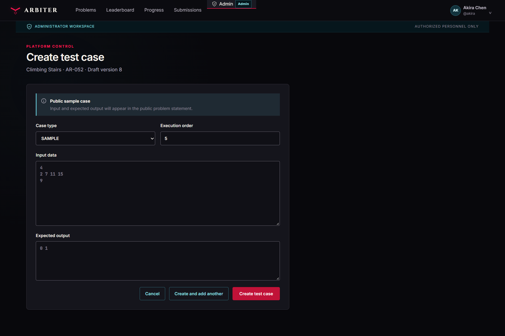

**Functions.** In addition to the shared shell functions in §12.1.1:

| Screen part | Trigger | Function |
|---|---|---|
| Case type selector | Change | Set `SAMPLE` or `HIDDEN` and update the visibility explanation before submission. |
| Create test case or Save changes | Submit | Validate and call the create or update operation with the case version in edit mode. |
| Create and add another | Click, create mode | Save the current case, keep the problem context, and reset the form for the next case. |
| Cancel | Click | Return to `SCR-ADM-03`; if the form is dirty, open `DLG-ADM-06` first. |
| Visibility explanation | Type change | Explain whether the case is public in the problem statement or hidden from participants. |
| Retry | Click, recoverable error | Re-submit only after the outcome is known or the latest version is loaded. |

**Field attributes.**

| Field | Length | Type | Attributes | Remarks |
|---|---|---|---|---|
| Problem identifier | 36 | uuid | `R` | Context; not editable. |
| Problem title | 1–200 | text | `R` | Context. |
| Case type | — | enum | `E`, `REQ` | `SAMPLE` or `HIDDEN`. |
| Execution order | 1–10,000 | integer | `E`, `REQ` | One-based; unique within the problem. |
| Input data | 1–1,048,576 B | code | `E`, `REQ` | Monospace textarea; the SRS does not fix a smaller content limit. |
| Expected output | 1–1,048,576 B | code | `E`, `REQ` | Monospace textarea; must be readable for publication. |
| Version | 1–n | integer | `R`, `CONC` | Present in edit mode only. |
| Visibility explanation | 0–200 | text | `R`, `DER` | Public sample or protected hidden case. |
| Unsaved changes | — | boolean | `HID` | Enables `DLG-ADM-06`. |

#### SCR-ADM-05 — User Management

**Screen specification.** Search, filter, page through, and inspect user accounts, and lock or unlock an account.

- **Route:** `/admin/users`.
- **Actors:** Administrator.
- **Boundary:** `AdminConsole` with `AccountApi.listUsers`, `AccountApi.getUserDetails`, and `AccountApi.changeUserStatus`.
- **Use case trace:** `UC-AD-U-01`, `UC-AD-U-02`, and `UC-AD-U-03`; related-user entry from `UC-AD-S-01`.
- **Regions:** Search field; account-status filter; user list; read-only selected-user panel; lock and unlock actions; pagination; notifications.
- **States:** Loading; populated or empty list; no matching users with the criteria retained; selected user active or locked; own-account action unavailable; already in the requested state; stale account version; system or network error.

**Screen image.** 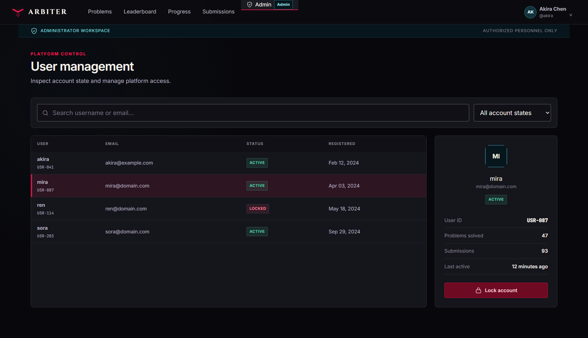

**Functions.** In addition to the shared shell functions in §12.1.1:

| Screen part | Trigger | Function |
|---|---|---|
| Search users | Initial, input, Enter | Filter by username or email. |
| Account status filter | Change | Restrict the list to `ALL`, `ACTIVE`, or `LOCKED`. |
| User row | Click, Enter, Space | Select the user and populate the read-only details panel. |
| Lock account | Click | Open `DLG-ADM-05`; confirmation locks the selected account. |
| Unlock account | Click | Open `DLG-ADM-05`; confirmation unlocks the selected account. |
| Previous page | Click | Request the previous page; disabled on the first page. |
| Next page | Click | Request the next page; disabled on the last page. |
| Page size control | Change | Change the number of users per page within the configured maximum. |
| Related user preselection | Initial, from `SCR-ADM-06` | Open this screen with the related user selected. |
| Retry | Click, error state | Reissue the list or details request and reload a stale version. |

**Field attributes.**

| Field | Length | Type | Attributes | Remarks |
|---|---|---|---|---|
| Search keyword | 0–254 | text | `E`, `OPT` | Matches username or email. |
| Account status filter | — | enum | `E`, `OPT` | `ALL` by default; `ACTIVE`, `LOCKED`. |
| Page | — | integer | `E`, `OPT` | One-based; default 1. |
| Page size | — | enum | `E`, `OPT` | 10, 25, 50, or 100; default 25. |
| User identifier | 36 | uuid | `R` | Mono font. |
| Username | 3–32 | text | `R` | Row identity. |
| Email address | 3–254 | email | `R` | Administrator-only view; never exposed publicly. |
| Account status | — | enum | `R` | `ACTIVE` or `LOCKED`; badge per §8.7. |
| Role | — | enum | `R` | `USER` or `ADMINISTRATOR`. |
| Registration date | — | date | `R`, `AUTO` | Account creation date. |
| Solved count | 0–n | integer | `R`, `AUTO` | Activity summary. |
| Submission count | 0–n | integer | `R`, `AUTO` | Activity summary. |
| Last active | — | datetime | `R`, `AUTO`, `OPT` | Relative time may be shown with an absolute title. |
| Version | 1–n | integer | `R`, `CONC`, `HID` | Retained for the status mutation. |
| Own account | — | boolean | `R`, `DER` | Disables lock and unlock for the acting administrator. |
| Action availability | — | enum | `R`, `DER` | Explains own-account or already-in-state disabling. |

#### SCR-ADM-06 — Submission Management

**Screen specification.** List submissions across all users and inspect one submission's source, verdict, metrics, compilation output, and per-case results in read-only mode.

- **Route:** `/admin/submissions`.
- **Actors:** Administrator.
- **Boundary:** `AdminConsole` with `SubmissionApi.listAllSubmissions` and `SubmissionApi.getAnySubmissionDetails`.
- **Use case trace:** `UC-AD-S-01`.
- **Regions:** Search field; problem, status, and verdict filters; submission list; read-only selected-submission panel; related owner and problem links; pagination.
- **States:** Loading; populated or empty list; filters applied; selected submission; no matching submissions; system or network error.
- **Security:** Hidden test-case inputs and expected outputs are never shown. There is no edit, rejudge, or delete action in v1.

**Screen image.** 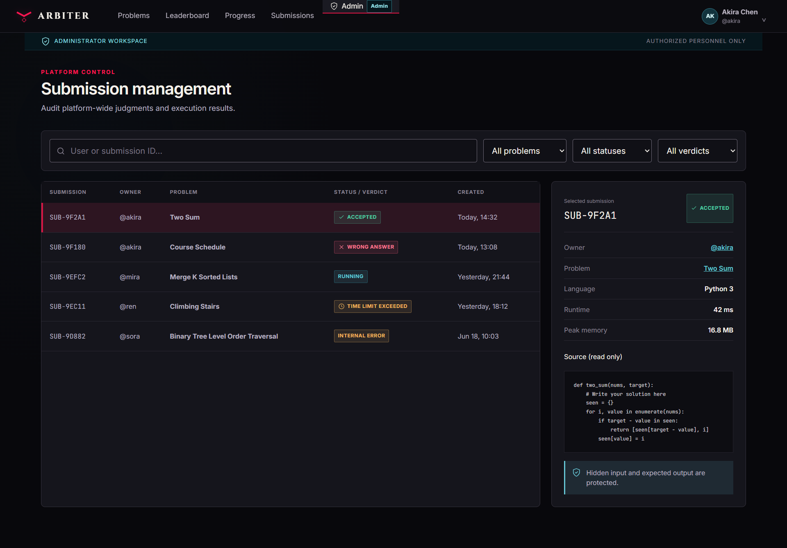

**Functions.** In addition to the shared shell functions in §12.1.1:

| Screen part | Trigger | Function |
|---|---|---|
| Search submissions | Initial, input, Enter | Filter by submitting user or submission identifier. |
| Problem filter | Change | Restrict the list to one problem or to all problems. |
| Status filter | Change | Restrict the list by processing status. |
| Verdict filter | Change | Restrict the list by verdict; `INTERNAL_ERROR` is not offered as a verdict. |
| Submission row | Click, Enter, Space | Select the submission and load the read-only details panel. |
| Owner link | Click | Open `SCR-ADM-05` with the related user selected. |
| Problem link | Click | Open `SCR-ADM-02` in edit mode for the related problem. |
| Previous page | Click | Request the previous page; disabled on the first page. |
| Next page | Click | Request the next page; disabled on the last page. |
| Page size control | Change | Change the number of submissions per page within the configured maximum. |
| Retry | Click, error state | Reissue the list or selected-submission request. |

**Field attributes.**

| Field | Length | Type | Attributes | Remarks |
|---|---|---|---|---|
| Search keyword | 0–200 | text | `E`, `OPT` | Matches username or submission identifier. |
| Problem filter | 0–200 | text | `E`, `OPT` | `ALL` by default. |
| Status filter | — | enum | `E`, `OPT` | `ALL`, `QUEUED`, `COMPILING`, `RUNNING`, `COMPLETED`, `INTERNAL_ERROR`. |
| Verdict filter | — | enum | `E`, `OPT` | `ALL`, `ACCEPTED`, `WRONG_ANSWER`, `TIME_LIMIT_EXCEEDED`, `MEMORY_LIMIT_EXCEEDED`, `RUNTIME_ERROR`, `COMPILATION_ERROR`; never `INTERNAL_ERROR`. |
| Page | — | integer | `E`, `OPT` | One-based; default 1. |
| Page size | — | enum | `E`, `OPT` | 10, 25, 50, or 100; default 25. |
| Submission identifier | 36 | uuid | `R` | Mono font. |
| Owner username | 3–32 | text | `R` | Link to `SCR-ADM-05`. |
| Problem title | 1–200 | text | `R` | Link to `SCR-ADM-02` in edit mode. |
| Language | — | enum | `R` | `CPP17` or `PYTHON3`. |
| Status | — | enum | `R` | Status badge per §5.2. |
| Verdict | — | enum | `R`, `OPT` | Present only for `COMPLETED`; badge per §5.3. |
| Runtime | 0–n | integer | `R`, `AUTO` | Milliseconds. |
| Peak memory | 0–n | decimal | `R`, `AUTO` | Megabytes. |
| Created time | — | datetime | `R` | Submission creation time. |
| Started time | — | datetime | `R`, `AUTO`, `OPT` | Empty until judging begins. |
| Completed time | — | datetime | `R`, `AUTO`, `OPT` | Empty until a terminal state is reached. |
| Source code | 0–65,536 B | code | `R` | Read-only; no edit action. |
| Compilation output | 0–16,384 B | text | `R`, `OPT` | Bounded and user-safe. |
| Case identifier | 36 | uuid | `R` | Historical identifier of the executed case. |
| Case outcome | — | enum | `R` | `PASSED`, `FAILED`, `SKIPPED`. |
| Case runtime | 0–n | integer | `R`, `AUTO` | Milliseconds. |
| Case memory | 0–n | decimal | `R`, `AUTO` | Megabytes. |
| Case message | 0–500 | text | `R`, `OPT` | Never contains hidden input or expected output. |