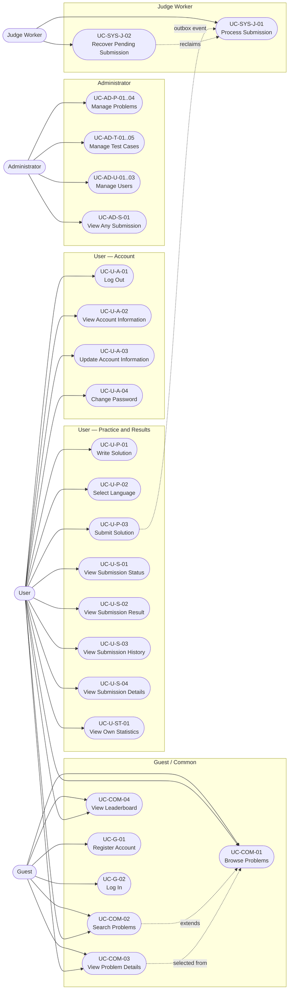

# Arbiter — v1 Use Case Catalog

**Status:** Baseline
**Version:** 1.1
**Date:** 2026-11-13
**Source of truth:** [`ProjectProposal/ProjectScope.md`](../../ProjectProposal/ProjectScope.md)
**Purpose:** Define the complete set of use cases for v1 before the SRS is drafted.

---

## 1. How to Use This Document

- This catalog is the authoritative list of v1 use cases. A feature not listed here is not in v1.
- Each use case has a specification file following [`SpecStructure.md`](./SpecStructure.md).
- The SRS will be derived from this catalog; requirement IDs will be assigned there.
- Contests, discussions, and other deferred features are listed in §10 but intentionally have no v1 specification.

---

## 2. Actors

| Actor | Type | Description |
|-------|------|-------------|
| Guest | Human | Unauthenticated visitor. Can browse public problems and the leaderboard, register, and log in. |
| User | Human | Authenticated account holder. Can solve and submit problems, track results, and view personal statistics. |
| Administrator | Human | Privileged account holder. Inherits all User behavior and manages problems, test cases, and user accounts. |
| Judge Worker | System | Background component that consumes submission jobs, sandboxes execution, evaluates outputs, and persists verdicts. |
| Outbox Dispatcher | System | Internal background process in the API that publishes committed outbox events to Redis. Not a standalone use case; documented as internal processing in UC-U-P-03. |

Administrator inherits User use cases. Where a use case lists "User, Administrator", the Administrator participates through inheritance.

---

## 3. Scope Guardrails

| Decision | Effect on use cases |
|----------|---------------------|
| Stateless JWT, no refresh token | Logout is client-side; expired tokens require re-login; password change invalidates all issued tokens via `password_changed_at`. |
| Transactional Outbox | Submission creation and queue-event persistence happen in one PostgreSQL transaction; a dispatcher publishes to Redis. |
| Two languages | Only C++17 and Python 3 appear in language selection, validation, and judging. |
| Test case editing only in DRAFT | Create, update, delete, type change, and reorder are rejected unless the problem is `ACTIVE` + `DRAFT`. |
| Basic statistics and leaderboard | Included; streaks, activity feeds, contest ratings, and advanced analytics excluded. |
| No contests, no discussions | No v1 use cases; see §10. |
| Docker limits only | CPU, memory, PIDs, time, network, filesystem, and capability restrictions; no gVisor/seccomp hardening in v1. |
| HTTP polling | Submission status is polled; no WebSocket/SSE use case. |

---

## 4. Use Case Inventory

### 4.1 Guest / Common

| ID | Use Case | Primary Actor(s) | Priority | Specification | Status |
|----|----------|------------------|----------|---------------|--------|
| UC-COM-01 | Browse Problems | Guest, User | High | `GuestCommon/UC-COM-01-BrowseProblems.md` | Existing |
| UC-COM-02 | Search Problems | Guest, User | High | `GuestCommon/UC-COM-02-SearchProblems.md` | Existing |
| UC-COM-03 | View Problem Details | Guest, User | High | `GuestCommon/UC-COM-03-ViewProblemDetails.md` | Amended |
| UC-COM-04 | View Leaderboard | Guest, User | Medium | `GuestCommon/UC-COM-04-ViewLeaderboard.md` | New |
| UC-G-01 | Register Account | Guest | High | `GuestCommon/UC-G-01-RegisterAccount.md` | Existing |
| UC-G-02 | Log In | Guest | High | `GuestCommon/UC-G-02-Login.md` | Amended |

### 4.2 User — Account

| ID | Use Case | Primary Actor(s) | Priority | Specification | Status |
|----|----------|------------------|----------|---------------|--------|
| UC-U-A-01 | Log Out | User, Administrator | High | `User/AccountAuthentication/UC-U-A-01-LogOut.md` | Amended |
| UC-U-A-02 | View Account Information | User, Administrator | High | `User/AccountAuthentication/UC-U-A-02-ViewAccountInformation.md` | Amended |
| UC-U-A-03 | Update Account Information | User, Administrator | Medium | `User/AccountAuthentication/UC-U-A-03-UpdateAccountInformation.md` | Amended |
| UC-U-A-04 | Change Password | User, Administrator | Medium | `User/AccountAuthentication/UC-U-A-04-ChangePassword.md` | New |

### 4.3 User — Practice

| ID | Use Case | Primary Actor(s) | Priority | Specification | Status |
|----|----------|------------------|----------|---------------|--------|
| UC-U-P-01 | Write Solution | User, Administrator | High | `User/ProblemPractice/UC-U-P-01-WriteSolution.md` | Existing |
| UC-U-P-02 | Select Programming Language | User, Administrator | High | `User/ProblemPractice/UC-U-P-02-SelectProgrammingLanguage.md` | Amended |
| UC-U-P-03 | Submit Solution | User, Administrator | High | `User/ProblemPractice/UC-U-P-03-SubmitSolution.md` | Amended |

### 4.4 User — Submissions

| ID | Use Case | Primary Actor(s) | Priority | Specification | Status |
|----|----------|------------------|----------|---------------|--------|
| UC-U-S-01 | View Submission Status | User, Administrator | High | `User/SubmissionHistory/UC-U-S-01-ViewSubmissionStatus.md` | Amended |
| UC-U-S-02 | View Submission Result | User, Administrator | High | `User/SubmissionHistory/UC-U-S-02-ViewSubmissionResult.md` | Amended |
| UC-U-S-03 | View Submission History | User, Administrator | High | `User/SubmissionHistory/UC-U-S-03-ViewSubmissionHistory.md` | Amended |
| UC-U-S-04 | View Submission Details | User, Administrator | Medium | `User/SubmissionHistory/UC-U-S-04-ViewSubmissionDetails.md` | Amended |

### 4.5 User — Progress

| ID | Use Case | Primary Actor(s) | Priority | Specification | Status |
|----|----------|------------------|----------|---------------|--------|
| UC-U-ST-01 | View Own Statistics | User, Administrator | Medium | `User/Progress/UC-U-ST-01-ViewOwnStatistics.md` | New |

### 4.6 Administrator

| ID | Use Case | Primary Actor(s) | Priority | Specification | Status |
|----|----------|------------------|----------|---------------|--------|
| UC-AD-P-01 | Create Problem | Administrator | High | `Administrator/ProblemManagement/UC-AD-P-01-CreateProblem.md` | Existing |
| UC-AD-P-02 | Update Problem | Administrator | High | `Administrator/ProblemManagement/UC-AD-P-02-UpdateProblem.md` | Existing |
| UC-AD-P-03 | Delete / Deactivate Problem | Administrator | High | `Administrator/ProblemManagement/UC-AD-P-03-DeleteProblem.md` | Existing |
| UC-AD-P-04 | Manage Problem Publication | Administrator | Medium | `Administrator/ProblemManagement/UC-AD-P-04-ManageProblemPublication.md` | Existing |
| UC-AD-T-01 | Create Test Case | Administrator | High | `Administrator/TestCaseManagement/UC-AD-T-01-CreateTestCase.md` | Existing |
| UC-AD-T-02 | Update Test Case | Administrator | High | `Administrator/TestCaseManagement/UC-AD-T-02-UpdateTestCase.md` | Existing |
| UC-AD-T-03 | Delete Test Case | Administrator | High | `Administrator/TestCaseManagement/UC-AD-T-03-DeleteTestCase.md` | Existing |
| UC-AD-T-04 | Manage Test Case Type | Administrator | Medium | `Administrator/TestCaseManagement/UC-AD-T-04-ManageTestCaseType.md` | Existing |
| UC-AD-T-05 | Reorder Test Cases | Administrator | Medium | `Administrator/TestCaseManagement/UC-AD-T-05-ReorderTestCases.md` | New |
| UC-AD-U-01 | View User List | Administrator | High | `Administrator/UserManagement/UC-AD-U-01-ViewUserList.md` | Existing |
| UC-AD-U-02 | View User Details | Administrator | High | `Administrator/UserManagement/UC-AD-U-02-ViewUserDetails.md` | Existing |
| UC-AD-U-03 | Manage User Status | Administrator | Medium | `Administrator/UserManagement/UC-AD-U-03-ManageUserStatus.md` | Existing |
| UC-AD-S-01 | View Any Submission | Administrator | Medium | `Administrator/SubmissionManagement/UC-AD-S-01-ViewAnySubmission.md` | New |

### 4.7 Judge Worker (System)

| ID | Use Case | Primary Actor(s) | Priority | Specification | Status |
|----|----------|------------------|----------|---------------|--------|
| UC-SYS-J-01 | Process Submission | Judge Worker | High | `System/Judge/UC-SYS-J-01-ProcessSubmission.md` | New |
| UC-SYS-J-02 | Recover Pending Submission | Judge Worker | High | `System/Judge/UC-SYS-J-02-RecoverPendingSubmission.md` | New |

**Total: 33 use cases** — 26 existing/amended, 7 new.

---

## 5. Actor–Use Case Matrix

| Use case | Guest | User | Administrator | Judge Worker |
|----------|:-----:|:----:|:-------------:|:------------:|
| UC-COM-01 Browse Problems | ✓ | ✓ | ✓ | — |
| UC-COM-02 Search Problems | ✓ | ✓ | ✓ | — |
| UC-COM-03 View Problem Details | ✓ | ✓ | ✓ | — |
| UC-COM-04 View Leaderboard | ✓ | ✓ | ✓ | — |
| UC-G-01 Register Account | ✓ | — | — | — |
| UC-G-02 Log In | ✓ | — | — | — |
| UC-U-A-01 Log Out | — | ✓ | ✓ | — |
| UC-U-A-02 View Account Information | — | ✓ | ✓ | — |
| UC-U-A-03 Update Account Information | — | ✓ | ✓ | — |
| UC-U-A-04 Change Password | — | ✓ | ✓ | — |
| UC-U-P-01 Write Solution | — | ✓ | ✓ | — |
| UC-U-P-02 Select Programming Language | — | ✓ | ✓ | — |
| UC-U-P-03 Submit Solution | — | ✓ | ✓ | — |
| UC-U-S-01 View Submission Status | — | ✓ | ✓ | — |
| UC-U-S-02 View Submission Result | — | ✓ | ✓ | — |
| UC-U-S-03 View Submission History | — | ✓ | ✓ | — |
| UC-U-S-04 View Submission Details | — | ✓ | ✓ | — |
| UC-U-ST-01 View Own Statistics | — | ✓ | ✓ | — |
| UC-AD-P-01 Create Problem | — | — | ✓ | — |
| UC-AD-P-02 Update Problem | — | — | ✓ | — |
| UC-AD-P-03 Delete / Deactivate Problem | — | — | ✓ | — |
| UC-AD-P-04 Manage Problem Publication | — | — | ✓ | — |
| UC-AD-T-01 Create Test Case | — | — | ✓ | — |
| UC-AD-T-02 Update Test Case | — | — | ✓ | — |
| UC-AD-T-03 Delete Test Case | — | — | ✓ | — |
| UC-AD-T-04 Manage Test Case Type | — | — | ✓ | — |
| UC-AD-T-05 Reorder Test Cases | — | — | ✓ | — |
| UC-AD-U-01 View User List | — | — | ✓ | — |
| UC-AD-U-02 View User Details | — | — | ✓ | — |
| UC-AD-U-03 Manage User Status | — | — | ✓ | — |
| UC-AD-S-01 View Any Submission | — | — | ✓ | — |
| UC-SYS-J-01 Process Submission | — | — | — | ✓ |
| UC-SYS-J-02 Recover Pending Submission | — | — | — | ✓ |

---

## 6. Use Case Diagram



---

## 7. Use Case Relationships

| Relationship | Use cases | Type | Notes |
|--------------|-----------|------|-------|
| Search extends browsing | UC-COM-02 → UC-COM-01 | Extend | Searching is an optional refinement of the problem list. |
| Details from list/search | UC-COM-01 / UC-COM-02 → UC-COM-03 | Navigation | The list and search results link to details. |
| Practice sequence | UC-U-P-01 → UC-U-P-02 → UC-U-P-03 | Precondition chain | A language must be selected before submission; submission requires source code. |
| Result tracking | UC-U-P-03 → UC-U-S-01 → UC-U-S-02 / UC-U-S-04 | Navigation | Polling leads to results or details. |
| History access | UC-U-S-03 → UC-U-S-02 / UC-U-S-04 | Navigation | History rows open result or detail views. |
| Statistics source | UC-U-S-03 → UC-U-ST-01 | Data dependency | Statistics are computed from submission data. |
| Admin content lifecycle | UC-AD-P-01 → UC-AD-T-01..05 → UC-AD-P-04 | Precondition chain | Test cases are managed while the problem is DRAFT, then the problem is published. |
| Test case order | UC-AD-T-05 → UC-AD-T-01 | Dependency | Reordering requires existing test cases. |
| Admin inspection | UC-AD-S-01 ← UC-U-P-03 | Data dependency | Administrators inspect submissions created by users. |
| Judge trigger | UC-U-P-03 → UC-SYS-J-01 | Trigger | The outbox dispatcher publishes the job; the worker consumes it. |
| Recovery | UC-SYS-J-02 → UC-SYS-J-01 | Recovery | Reclaims and reprocesses jobs left pending by worker failure. |

---

## 8. Lifecycle Models

### 8.1 Submission Lifecycle

```
QUEUED → COMPILING → RUNNING → COMPLETED
   │                      │
   └──────────────────────┴──→ INTERNAL_ERROR
```

| State | Meaning |
|-------|---------|
| `QUEUED` | Submission record committed; outbox event not yet consumed by a worker. |
| `COMPILING` | Worker is compiling (C++17) or syntax-checking (Python 3). |
| `RUNNING` | Worker is executing the program against test cases. |
| `COMPLETED` | Judging finished and a verdict is stored. |
| `INTERNAL_ERROR` | Infrastructure failure prevented a trustworthy verdict. |

Terminal states are `COMPLETED` and `INTERNAL_ERROR`. `INTERNAL_ERROR` is a terminal status, not a verdict; the UI presents it as a system error.

### 8.2 Verdicts

| Verdict | Set when |
|---------|----------|
| `ACCEPTED` | All executed test cases pass. |
| `WRONG_ANSWER` | Output token sequence differs from expected output. |
| `TIME_LIMIT_EXCEEDED` | Execution exceeds the problem time limit. |
| `MEMORY_LIMIT_EXCEEDED` | Execution exceeds the problem memory limit or is OOM-killed. |
| `RUNTIME_ERROR` | Program exits non-zero or is killed by a signal other than the timeout/OOM controls. |
| `COMPILATION_ERROR` | Compilation (or Python syntax check) fails or exceeds the compilation timeout. |

### 8.3 Problem Lifecycle

| Field | Values | Meaning |
|-------|--------|---------|
| `status` | `ACTIVE`, `INACTIVE` | Logically an enum; stored as the `is_active` boolean. `INACTIVE` is the soft-deleted/archived state; data and submissions are preserved. |
| `publication_status` | `DRAFT`, `PUBLISHED` | Only `ACTIVE` + `PUBLISHED` problems are publicly visible and submittable. |

- Creating a problem produces `ACTIVE` + `DRAFT`.
- Deleting a problem sets `INACTIVE` + `DRAFT` (reversible).
- Editing a published problem's metadata is allowed; editing its test cases is not.
- Test case operations require `ACTIVE` + `DRAFT`.
- Publishing requires at least one sample test case and one hidden test case, a non-empty statement, and positive time/memory limits.

### 8.4 Test Case Lifecycle

- Types: `SAMPLE`, `HIDDEN`.
- Sample cases are returned by UC-COM-03. Hidden cases are never returned by any public or submission endpoint.
- `ordinal` is unique and contiguous within a problem; judging executes cases in ascending order.
- Sample/hidden flags and order may change only while the problem is `DRAFT`.
- Hidden inputs and expected outputs are visible only through administrator test-case management, never through submission results.

---

## 9. Cross-Cutting Business Rules

### 9.1 Authentication and Authorization

- Passwords are hashed with Argon2id.
- Login issues a signed JWT (HS256) with `sub`, `role`, `iat`, and `exp`; lifetime is 24 hours.
- No refresh token exists in v1.
- Tokens whose `iat` predates `users.password_changed_at` are rejected.
- Disabled accounts are rejected on every authenticated request, regardless of token validity.
- Logout only clears client storage; it does not revoke the token.
- Administrative endpoints require `role = admin` on the backend, not only in the UI.
- Source code is visible only to its owner and to administrators.

### 9.2 Submission and Judging

- Source size limit: 64 KiB.
- Submission throttle: one per User per 5 seconds.
- Time limit: per test case, wall-clock, measured inside the execution container.
- Memory limit: per test case, enforced by the container; peak memory recorded from cgroup data where available.
- Compilation: 10-second timeout, 512 MiB.
- Output cap: 1 MiB; larger output is treated as `WRONG_ANSWER`.
- Output comparison: normalize CRLF to LF, split on whitespace, compare token sequences exactly and case-sensitively.
- Execution model: one compile container per submission, one fresh execution container per test case.
- Judging stops at the first failing test case; results are stored for executed cases only.
- Container settings: `--network none`, `--cpus 1`, `--pids-limit 64`, `--read-only`, `--cap-drop ALL`, `--security-opt no-new-privileges`, non-root user, size-limited tmpfs, no host mounts except read-only inputs/artifacts.
- Jobs are published through the transactional outbox to Redis Stream `judge:submissions`, consumed by group `judge-workers`, and acknowledged only after the result is committed.
- At most two attempts per job; a third failure produces `INTERNAL_ERROR`.
- Duplicate delivery is idempotent: terminal submissions are not judged again.
- A missing or unreadable test-case file produces `INTERNAL_ERROR`, never `ACCEPTED`.

### 9.3 Statistics

- Attempted problems: distinct non-archived problems with at least one submission by the user.
- Solved problems: distinct non-archived problems with at least one `ACCEPTED` submission by the user.
- Acceptance rate: accepted submissions ÷ total submissions (0 when there are no submissions).
- Difficulty and tag breakdowns use the same attempted/solved rules.
- Leaderboard: active users only; ranked by solved count descending, total submissions ascending, then username ascending.
- Unpublishing a problem does not remove it from a user's solved count; archiving does.
- Public problem statistics: total submissions, accepted submissions, acceptance rate.
- Recent submissions on the profile: latest 10.

### 9.4 Error Handling

- All exception flows follow [`SpecStructure.md`](./SpecStructure.md) §2.
- Error codes use `ERR-<CAT>-<NNN>`, with one code per distinct condition. Codes are stable and are never renumbered or reused.
- HTTP mapping: `ERR-VAL` → 400/422, `ERR-AUTH` → 401, `ERR-ACC` → 403, `ERR-RES` → 404, `ERR-PERM` → 403, `ERR-CONFLICT` → 409, `ERR-LIMIT` → 429, `ERR-SYS` → 500/503, `ERR-NET` → client-side.
- Responses never expose stack traces, SQL, container internals, hidden test data, or secrets.

---

## 10. Deferred Use Cases (Post-v1)

These are deliberately excluded. They will be specified in a later iteration, not in v1.

| Area | Deferred use cases |
|------|--------------------|
| Contests | Create/manage contest, register for contest, submit during contest, view standings, calculate rating |
| Discussions | Create thread, comment, reply, edit/delete own post, like/react, report content, moderate |
| Practice extras | Run against sample cases without creating a submission |
| Languages | Add Go (and any further languages) |
| Account | Email verification, self-service password reset, refresh tokens, 2FA, account deletion, avatar upload |
| Statistics | Streaks, activity heatmap, per-language statistics, time-series charts, CSV export |
| Judging | Special judge, floating-point tolerance, interactive problems, test-case groups and weights, rejudge UI |
| Administration | Audit log, bulk operations, granular permissions, impersonation, moderation queue |
| Operations | Multi-worker load testing, autoscaling, Kubernetes deployment, gVisor/seccomp/AppArmor hardening, object storage for test cases |
| Delivery | WebSocket/SSE result push, advanced rate limiting |

---

## 11. Traceability

| Use case | Scope section | Proposal FRs | Notes |
|----------|---------------|--------------|-------|
| UC-COM-01 | §5.2 | FR-007 | Problem list |
| UC-COM-02 | §5.2 | FR-008 | Search and filters |
| UC-COM-03 | §5.2 | FR-009 | Details, samples, stats |
| UC-COM-04 | §5.6 | FR-025 | Global leaderboard |
| UC-G-01 | §5.1 | FR-001 | Registration |
| UC-G-02 | §5.1 | FR-002 | Login |
| UC-U-A-01 | §5.1 | FR-002 | Logout (client-side) |
| UC-U-A-02 | §5.1 | FR-003 | View profile |
| UC-U-A-03 | §5.1 | FR-003 | Update profile |
| UC-U-A-04 | §5.1 | FR-004 | Change password |
| UC-U-P-01 | §5.4 | FR-013 | Editor |
| UC-U-P-02 | §5.4 | FR-014 | Language selection |
| UC-U-P-03 | §5.4 | FR-013, FR-015 | Submission and queuing |
| UC-U-S-01 | §5.4 | FR-021 | Status polling |
| UC-U-S-02 | §5.4 | FR-020, FR-022 | Result |
| UC-U-S-03 | §5.4 | FR-021 | History |
| UC-U-S-04 | §5.4 | FR-022 | Details |
| UC-U-ST-01 | §5.6 | FR-023, FR-024 | Own statistics |
| UC-AD-P-01 | §5.2, §5.7 | FR-010, FR-011 | Create problem |
| UC-AD-P-02 | §5.2, §5.7 | FR-010, FR-011 | Update problem |
| UC-AD-P-03 | §5.2, §5.7 | FR-010 | Soft delete |
| UC-AD-P-04 | §5.2, §5.7 | FR-010 | Publish/unpublish |
| UC-AD-T-01 | §5.3, §5.7 | FR-012 | Create test case |
| UC-AD-T-02 | §5.3, §5.7 | FR-012 | Update test case |
| UC-AD-T-03 | §5.3, §5.7 | FR-012 | Delete test case |
| UC-AD-T-04 | §5.3, §5.7 | FR-012 | Sample/hidden |
| UC-AD-T-05 | §5.3, §5.7 | FR-012 | Reorder |
| UC-AD-U-01 | §5.1, §5.7 | FR-006 | User list |
| UC-AD-U-02 | §5.1, §5.7 | FR-006 | User details |
| UC-AD-U-03 | §5.1, §5.7 | FR-006 | Enable/disable |
| UC-AD-S-01 | §5.4, §5.7 | FR-022 | Admin submission inspection |
| UC-SYS-J-01 | §5.5 | FR-016 – FR-020 | Core judging |
| UC-SYS-J-02 | §5.5 | FR-020 | Recovery and idempotency |

The SRS will map these to `FR-*` and `NFR-*` identifiers and add the non-functional requirements that do not belong in use cases.

---

## 12. Assumptions and Open Questions

| # | Assumption / question | Current position |
|---|-----------------------|------------------|
| 1 | Time limit semantics | Wall-clock per test case, measured inside the container; compilation has a separate fixed limit. |
| 2 | Python syntax errors | Python is syntax-checked with `py_compile` during `COMPILING`, so syntax errors produce `COMPILATION_ERROR`, not `RUNTIME_ERROR`. |
| 3 | Empty output | Compared as an empty token sequence; matches only an empty expected output. |
| 4 | Peak memory source | cgroup v2 `memory.peak` where available; otherwise record `NULL` rather than a guessed value. |
| 5 | Problem edited while jobs are queued | Test-case edits require `DRAFT`; the system warns administrators not to unpublish with queued/running submissions but does not block in v1. |
| 6 | Unpublished problems in stats | Counted as long as the problem is not `INACTIVE`; prevents rank drops after unpublishing. |
| 7 | Leaderboard visibility | Public, read-only. |
| 8 | Admin password resets | Not available in v1; users must use UC-U-A-04. |
| 9 | Username changes | Not available in v1; username is immutable. |
| 10 | Multiple test-case files per case | Not supported; one input file and one expected-output file per test case. |
| 11 | Rejudging | No UI in v1; a submission is judged once. |
| 12 | "Run against samples" | Deferred; users must submit to see results. |

---

## 13. Change Log

| Version | Date | Change |
|---------|------|--------|
| 1.0 | 2026-11-13 | Baseline catalog created. 33 use cases (26 existing/amended, 7 new). Refresh-token flows removed in favour of stateless JWT. Transactional outbox retained. Test-case editing restricted to DRAFT problems. Contests and discussions deferred. |
| 1.1 | 2026-11-13 | Updated §9.4 error handling to the `ERR-<CAT>-<NNN>` format, one-code-per-condition rule, and the `ERR-CONFLICT` → 409 mapping. |
